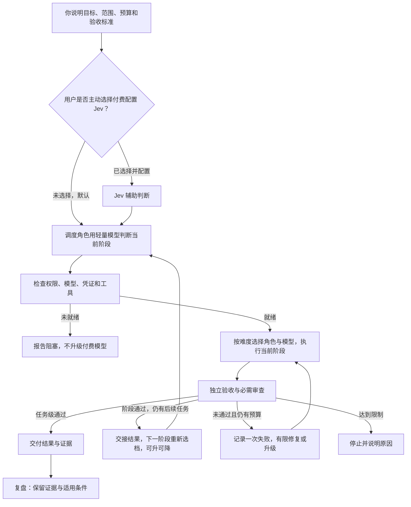
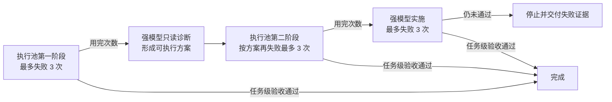

# AI 分工工作流：免费优先，按需升级，独立验收

**按当前任务难度选择够用的模型，遇到难题升级，难点解决后降回适合后续任务的档位，最后用检查结果判断有没有做好。**

这是面向初学者和 AI Agent 的安装、配置与使用指南。你提供目标、账户和授权，自己的 Agent 根据本文完成本机配置。优先复用已有工具与环境。

> **先看这里**
> - 🟢 Jev 可选；默认由调度角色使用轻量模型判断，想配置 Jev 请主动说明，使用其 API 需要付费。
> - 🟠 免费额度可能限时限量；付费兜底须先授权。
> - 🔴 模型说“完成了”不算验收通过。
> - 本仓库提供文档，不包含安装器。“一键交给 AI”是复制配置任务，不是点击网页就自动改电脑。

## 先分清：官网、项目页、本机 API

| 你要做什么 | 正确入口 | 怎样使用 |
| --- | --- | --- |
| 了解 Magpie、查看产品说明和下载入口 | **[Magpie 官网](https://usemagpie.ai/)** | 可以用浏览器打开 |
| 查看源码、发行版本与问题记录 | **[Magpie 官方 GitHub 项目](https://github.com/yetone/magpie)** | 可以用浏览器打开 |
| 让 Codex 连接本机 Magpie | `http://127.0.0.1:3425/v1` | **填入程序的 `base_url`；不是网页，不作为网站打开** |
| 使用已安装的本机管理界面 | Magpie 应用 | 从应用本身进入 |

**`127.0.0.1` 指访问者自己的电脑。** 别人复制这个地址，不会连接到作者的电脑。`/v1` 是 API 路径前缀，浏览器没有显示网页，不能据此判断网关是否故障。

本机地址在本页只作为配置值展示。它不是官网，也不是公开分享链接。

## 一键交给自己的 AI

1. 将本仓库下载或克隆到自己的工作目录，或让 Agent 读取仓库中的两个文档。
2. 点击下面代码块的复制按钮，将指令交给自己具有本机操作能力的 Agent。
3. 本人完成账户登录和必要授权，最后查看 Agent 的配置差异与验收结果。

```text
请读取本仓库 README.md 和 AI_SETUP.md，按照 AI_SETUP.md 完成本机检查、必要安装、配置和验收。
先复用现有环境，备份将修改的配置；只修改本任务所需内容。
默认由调度角色使用轻量模型判断任务、编排器派工，不主动调用 Jev 分类。只有我主动提出配置 Jev 并明确费用授权后，才接入使用。
付费或套餐额度的使用范围，以我已有的明确授权为准；不明确时先询问，未授权渠道不得进入自动回退池。
密钥由我在本机交互输入，不写进聊天、命令参数或日志。需要登录、验证码或真实人工授权时由我完成。
模型名称和推理档位按 README.md 核对；缺少模型、凭证、工具或权限时报告阻塞，不静默替换。
不要把文档中的流程当成已经实现。如果现有编排器不能落实失败计数、超时、权限或验收绑定，说明缺口，不擅自开发复杂新系统。
交付配置变更、回退方法和实际验收结果，区分配置完成、请求成功和任务完成。
```

复制指令不会安装软件、读取凭证或修改电脑。实际操作由你的 Agent 在已授权的范围内执行。没有账户权限或缺少编排实现时，不能承诺一次操作就完整复刻。

## 1. 先看懂这支“小团队”

| 分工 | 负责什么 |
| --- | --- |
| 你 | 目标、允许改什么、成本上限、怎样算做好 |
| 调度者 | 用轻量模型判断当前阶段的能力与工具需求，由编排器分配角色与模型 |
| 规划者 | 为复杂任务制定战略、大策划与执行部署方案，明确分工后交接 |
| 执行者 | 按明确范围读取、整理、修改或运行检查 |
| 验收者 | 用事先确定的检查和必要的独立审查核对结果 |

这些角色按职责分工，模型随当前阶段的难度升降档位。复杂任务由 Astra 完成大策划、战略和执行部署安排，交接后由轻量调度角色和低成本执行模型推进；小任务直接进入轻量流程。已知文件与验收标准时，不重复侦察。只有能独立推进且不争用文件或状态的工作才并行。



Jev 的建议不能生成权限；调度角色接管判断或调整模型档位，也不能绕过风险拒绝或人工确认。

<a id="jev-option"></a>

## 2. 可选配置：Jev 决策辅助

**Jev 是付费选项。想配置请主动告诉你的 Agent；未主动说明时，默认由调度角色使用轻量模型判断任务，不自动接入或调用 Jev 分类。**

**它能做什么**：Jev 是 TypeSafe 的决策模型，可以从候选项中选择（Choice）、按标准评分（Score），或判断一个条件成立的概率（Noul），返回供程序使用的结构化结果。见[官方功能说明](https://docs.typesafe.ai/primitives)。

**我们用它做什么**：把精简任务摘要交给 Jev，主要用 Choice 辅助判断所需能力档位，并辅助识别风险；调度角色／编排器按下表安排角色与模型。Jev 本身不写代码、不操作工具，也不代替独立验收。

配置方式见 [Jev 可选接入](AI_SETUP.md#jev-setup)。费用以账户计费为准，不保证节省总成本；仅发送获授权的精简摘要，密钥留在本机安全配置。

<a id="tier-assignment"></a>

### 任务级别与具体分工

默认使用现有 `group/free-basic` 提供轻量分类判断，由编排器结合所需工具、权限和验收要求，分配当前阶段最低够用的角色与模型。**角色表示职责，级别表示所需能力，任务类型决定能否写入。** 大策划完成后交接给低成本模型执行；出现困难再按既有规则升级，困难解决或进入简单子任务后重新降档。同一任务／计数阶段不因升降档而重置失败次数。

| 级别 | 适用任务与例子 | 分配给谁、使用什么模型 | 执行安排 |
| --- | --- | --- | --- |
| **L1 · LIGHT** | 已知文件查找、短摘要、步骤完全明确的机械修改 | 纯文本小任务用基层池 **`group/free-basic`**；需要文件工具时，只读侦察用 **Scout**、获授权的机械修改用 **Operator**，两者使用免费优先执行池 `group/codex-exec-max` / MAX | 轻量判断选档，编排器派工，由对应模型或执行池完成。Operator 只能修改已指定文件，遇到实质设计问题再升级 |
| **L2 · STANDARD** | 范围明确的功能实现、常规 bug 修复、资料分析或代码审查 | 实施用 **Coder**：`group/codex-exec-max` / MAX；只读分析、常规诊断或审查用 **Analyst**：`gpt-6.1-sol` / High | Coder 按范围实施；Analyst 只提供分析或修复方案，不能自行改文件。交付后按预定标准独立验收 |
| **L3 · DEEP** | 大策划、战略与执行部署、跨模块架构、困难诊断 | **Architect**：`gpt-6-astra` / Xhigh，只读规划与诊断 | 明确任务拆分、角色分工、依赖、允许范围与验收要求后，交接给轻量调度和低成本执行模型；Astra 不持续参与常规派工。达到失败升级条件后，才由获授权的 **Astra Executor** 实施 |
| **L4 · HUMAN_GATE** | 不可逆操作、需要人工决定的权限或风险事项 | **交给用户确认**，不自动派写入角色 | 暂停相关执行，说明待确认动作与影响；获得授权后重新确定范围与可执行档位。L4 是人工门禁，不是更贵的模型 |

执行池优先顺序为 **WorkBuddy DeepSeek → Cloudflare Qwen → 已授权的 Luna 兜底**，精确 ID 见下一节。常规失败升级使用 **Analyst / Sol High** 诊断、**Sol Executor / Sol High** 实施；困难任务使用 **Architect / Astra Xhigh** 诊断、**Astra Executor / Astra Xhigh** 实施。

实施失败按后文的 **执行池 3 次 → 强模型只读诊断 → 执行池再 3 次 → 强模型实施最多 3 次**处理；任务级验收及必需审查通过才结束，仅有规划或诊断阶段通过不代表实现任务结束。模型、渠道或权限不可用属于阻塞，不能靠升级档位自动获得权限或费用授权。

## 3. 工具与原版模型

以下是 **2026-10-26 的参考快照**，不是“这些版本永远最新”的声明。其他账户的模型权限和免费政策可能不同。

| 工具 | 参考版本 | 用途 |
| --- | --- | --- |
| [Codex](https://github.com/openai/codex) | `0.163.0` | Agent 运行环境、角色执行与工具调用 |
| [Magpie](https://github.com/yetone/magpie) | `0.1.1453` | 模型渠道、组与回退 |
| [FastCtx](https://github.com/yc-duan/fastctx) | `0.2.5` | 本地读取、搜索与命令执行 |

Codex 的网关 provider 名为 `magpie`，`wire_api` 为 `responses`，`base_url` 为 `http://127.0.0.1:3425/v1`。执行角色单独绑定模型，保留使用者已有会话设置。

### 免费优先执行池

执行层使用**免费优先执行池**，组名为 `codex-exec-max`，调用 ID 为 **`group/codex-exec-max`**。

**这个 ID 是自定义路由组名，不是模型，也不是单独收费的服务。** 真正执行任务的是下表中的模型，费用取决于最终调用的渠道与使用者账户。路由为 `order`，亲和性为 `turn`：按顺序优先选择可用来源并回退，不代表自动比较实时价格。

| 顺序 | 精确成员 ID | 分工 |
| --- | --- | --- |
| 1 | `workbuddy-ai/deepseek-v4.1-flash:max` | 优先执行 |
| 2 | `cloudflare-ai/@cf/qwen/qwen3.8-27b:xhigh` | 第二执行来源 |
| 3 | `codex/gpt-6-luna:max` | 低成本兜底，先获得额度或费用授权 |

WorkBuddy 使用 `@magpie-community/opencode-workbuddy-auth@0.1.34`，登录自己的 `workbuddy-ai` 账户；Cloudflare 使用自己的账户 ID 和 token。

执行角色配置为 MAX，各成员使用表中的档位。Cloudflare 成员实际是 Xhigh，不把外层 MAX 当成所有上游都支持同名参数。

### 基层短任务池

组名：`free-basic`；调用 ID：**`group/free-basic`**。同样使用 `order` 和 `turn`：

1. `groq/openai/gpt-oss-20b:high`
2. `deepseek-2/deepseek-flash:max`

用于轻量分类、字段提取和短摘要。Groq 使用 Chat Completions 接口。小额免费额度适合小任务，标称上下文很大不代表免费额度足以支撑长时间代理任务。

### 角色模型与权限

| 角色 | 模型 / 推理档位 | 分工与权限 |
| --- | --- | --- |
| 任务判断 | `group/free-basic` / 各成员配置 | 轻量分类建议；实际派工由编排器执行 |
| Scout | 免费优先执行池：`group/codex-exec-max` / `max` | 只读侦察 |
| Operator | 免费优先执行池：`group/codex-exec-max` / `max` | 获授权的明确操作 |
| Coder | 免费优先执行池：`group/codex-exec-max` / `max` | 获授权的编码与修复 |
| Analyst | `gpt-6.1-sol` / `high` | 常规问题的只读诊断 |
| Architect | `gpt-6-astra` / `xhigh` | 大策划、战略、执行部署或困难问题的只读诊断；完成后交接 |
| Sol Executor | `gpt-6.1-sol` / `high` | 获授权后的强模型实施 |
| Astra Executor | `gpt-6-astra` / `xhigh` | 困难任务升级后的实施 |

具体选档、任务类型与升级安排见[任务级别与具体分工](#tier-assignment)。

只读诊断与写入实施分开；交接只带目标、必要材料、允许范围和验收要求。

<details>
<summary>展开原版顶层智能组与 Kimi 审查渠道</summary>

原版顶层智能组的分类器为 `group/free-basic`；规划分支为 `codex/gpt-6-astra:xhigh`；执行分支为 `group/codex-exec-max`；审查分支为 `group/auto-kimi-k3`。

Kimi 自动组也可能显示为 `auto/kimi-k3`。原配置涉及 `moonshot-cn/kimi-k3`、`opencode-go/kimi-k3`、`moonshot/kimi-k3`，实际成员取决于自己的账户。

使用顶层智能组时，由它选择分支；已经明确分配角色的任务直接调用角色绑定的模型或池，不重复分类。自动生成的组也要检查实际成员及费用授权。组内回退不等于完成规划、实施和审查，Kimi 意见不能代替独立验收。

</details>

## 4. 先控制费用，再开放自动回退

运行前确定允许渠道、账户、额度上限和耗尽后的处理方式。**未授权渠道不得留在可自动调用的列表中；授权后再按参考顺序启用。** 将限制落实到配置或调用入口，不能只写提示词。

免费额度可能 **限时、限量、限地区或限账户**，不保证永久可用。同一接口在别人的账户里可能收费。

额度用完，可自行评估新来源并重新配置；不想维护，可在明确费用授权后使用低成本付费兜底。免费额度耗尽不会自动产生新的费用授权。会话调用、强模型、Luna和部分 Kimi 渠道都可能收费或消耗套餐额度。

本仓库不提供免费 API 聚合个人网站的名称、链接或接口，也不为其背书。新增来源前重新确认数据发送范围、权限、可靠性和费用。

## 5. 失败怎样算，怎样升级

先排除前置阻塞和渠道故障，再计算能力失败。

| 情况 | 处理 |
| --- | --- |
| 缺凭证、缺模型、权限不足、必要工具不可用 | 报告前置阻塞并停止，不扣能力次数、不自动升级付费模型 |
| 网络错误、429、额度耗尽 | 单独记录，按预设上限处理；不无限重试 |
| 一次完整交付未通过独立验收或必需审查 | 计一次能力失败 |
| 排除上述阻塞/渠道故障后，仍无有效交付或格式不合格 | 计一次能力失败 |
| 同一交付的测试与审查都失败 | 仍只计一次 |
| 修复后重新提交 | 新的一次实施尝试 |
| 组内换渠道、过程自检、单次工具调用 | 不单独计一次能力失败 |

每个计数阶段的次数由整个执行池共享，不是每个模型各有三次。恢复同一阶段或切换模型，不重置计数。



常规诊断用 Sol High，困难诊断用 Astra Xhigh。强模型实施须使用获授权的写入角色。诊断无可执行方案，或下一阶段缺少权限、模型、预算时停止。任何限制都可让流程提前停止，无需把次数用满。

**统一时间与步骤口径：**

- 一个计数阶段最多三次实施尝试。
- 单次模型派工及其工具执行最多 **600 秒**。
- 单次独立验收另限 **120 秒**。
- 最多 **21 次角色派工**，包括实施、重试、诊断和审查；单次工具调用不另算一步。
- 21 步不会增加 3＋3＋3 的实施次数。次数、时间或预算任一先到上限，就停止。

保留每次失败证据和已有成果，后续从原结果继续。计数、超时、权限和预算限制需要实际机制落实，不能用提示词声明代替验证。

## 6. 什么才叫完成

**阶段交接合格只允许进入下一阶段。用户目标对应的交付物通过任务级验收与必需审查，才叫完成。** 对实现任务而言，诊断方案合格不等于实现完成。

验收和审查必须对应同一候选内容。修改后重新执行受影响的检查和必要审查，不沿用已经失效的通过结论。

| 接手 Agent 应交付 | 如何判断 |
| --- | --- |
| 角色配置 | 精确模型、档位、权限与实际加载状态一致 |
| 可调用的调度入口 | 能按任务调用对应角色或模型组 |
| 失败记录 | 绑定任务和计数阶段，换模型不重置 |
| 超时与权限/预算限制 | 实际生效，到上限明确停止 |
| 独立验收与必需审查结果 | 对应当前候选，使用调用方确定的标准 |
| 未就绪提示与回退方法 | 缺模型、凭证、工具或授权时明确阻塞；能恢复配置 |

分别记录“配置完成”“请求返回”“任务验收通过”。HTTP 200、退出码 0、模型自报完成都不能代替任务验收。最终模型没有可靠回显时写“未核实”；未知用量不记为零。缺模型不静默替换后声称完全复刻。

## 7. 初学者先做一个小任务

> 修复一个加法函数，使现有四项测试通过；只修改实现文件，测试文件不得修改。

先确认问题能复现，再给执行角色明确范围与验收命令，由独立检查进程验证原测试及禁止修改的文件。通过后报告实际调用、结果与未知消耗；未通过则按上面的口径记录并升级。

先跑通小型只读任务与修改任务，再增加复杂分工。GitHub Queue 是可选入口，只负责接收和排队，仍走同一授权与验收链；Issue 正文不能自行授予写权限或费用授权。

## 8. Magpie 脱敏与访问保护

公开配置、截图、日志与备份前都要检查：

- API key、token、Cookie、OAuth 凭证和授权请求头替换为占位符。
- 移除账号信息、个人邮箱、私有仓库地址、私人路径，以及 URL 中嵌入的账户标识。
- 不公开完整聊天、原始请求/响应日志、认证缓存、未经审查的配置导出与备份。
- 如使用 Magpie 的脱敏功能，按安装版本的官方说明确认设置并用合成样本检查效果；不能仅凭功能名称认定全部敏感数据已被保护。

**检查网关实际仅监听本机地址，例如 `127.0.0.1`。客户端填 localhost，不等于服务端没有对外监听。** 不默认开放公网、局域网共享、端口转发或无认证代理。确需远程使用时，另行配置身份认证、加密连接和访问限制。

使用可信来源的工具与插件，限制凭证文件读取权限，避免进入公开仓库或不受控的共享目录。

**脱敏降低泄露风险，不保证防入侵。** 凭证泄露后应撤销或轮换并检查访问记录；删除公开文本不等于泄露已解决。

## 9. 证据与复盘边界

原项目截至 2026-10-26 的记录涉及 Windows 下真实 CLI 工具调用、免费池小型代码修复、基层分类/提取/摘要、隔离只读队列等功能验证。它们不是其他账户和环境的成功保证。

目前没有可据此承诺固定收益的完整项目账单或严格成本对照。本指南不承诺永久免费、固定节省比例或所有任务更快。本文补充的执行口径需要在接入环境逐项验证。

结束后记录做法、证据、适用条件和失败反例。经验先作为候选，不自动改全局规则；旧任务的 PASS 不证明新任务通过。

---

**给 AI 的执行顺序与完成条件：**[AI_SETUP.md](AI_SETUP.md)

本页采用 GitHub 支持的 Mermaid 流程图和 Markdown 表格，不依赖自建网页服务。参见 [GitHub 官方图表文档](https://docs.github.com/en/get-started/writing-on-github/working-with-advanced-formatting/creating-diagrams)。
