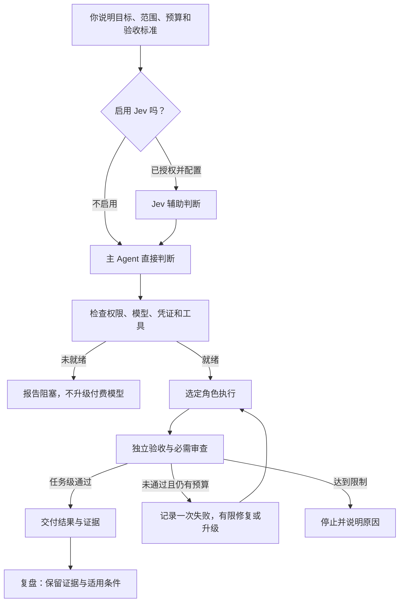
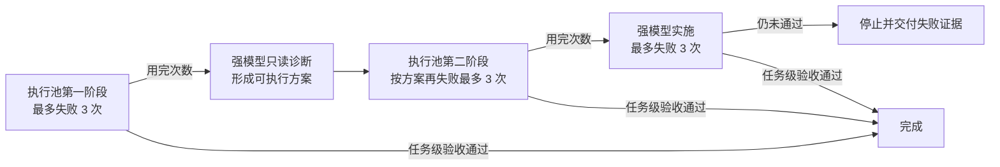

# AI 分工工作流：免费优先，按需升级，独立验收

**把明确的工作交给够用的模型，遇到难题再升级，最后用检查结果判断有没有做好。**

这是面向初学者和 AI Agent 的安装、配置与使用指南。你提供目标、账户和授权，自己的 Agent 根据本文完成本机配置。优先复用已有工具与环境。

> **先看这里**
> - 🟢 Jev 可选，没有 API key 也能开始。
> - 🟠 免费额度可能限时限量；付费兜底须先授权。
> - 🔴 模型说“完成了”不算验收通过。
> - 本仓库提供文档，不包含安装器。“一键交给 AI”是复制配置任务，不是点击网页就自动改电脑。

## 先分清：官网、项目页、本机 API

| 你要做什么 | 正确入口 | 怎样使用 |
| --- | --- | --- |
| 了解 Magpie、查看产品说明和下载入口 | **[Magpie 官网](https://usemagpie.ai/)** | 可以用浏览器打开 |
| 查看源码、发行版本与问题记录 | **[Magpie 官方 GitHub 项目](https://github.com/yetone/magpie)** | 可以用浏览器打开 |
| 让 Codex 连接本机 Magpie | `http://127.0.0.1:3425/v1` | **填入程序的 `base_url`；不是网页，不作为网站打开** |
| 使用已安装的本机管理界面 | Magpie 应用 | 从应用本身进入 |

**`127.0.0.1` 指访问者自己的电脑。** 别人复制这个地址，不会连接到作者的电脑。`/v1` 是 API 路径前缀，浏览器没有显示网页，不能据此判断网关是否故障。

本机地址在本页只作为配置值展示。它不是官网，也不是公开分享链接。

## 一键交给自己的 AI

1. 将本仓库下载或克隆到自己的工作目录，或让 Agent 读取仓库中的两个文档。
2. 点击下面代码块的复制按钮，将指令交给自己具有本机操作能力的 Agent。
3. 本人完成账户登录和必要授权，最后查看 Agent 的配置差异与验收结果。

```text
请读取本仓库 README.md 和 AI_SETUP.md，按照 AI_SETUP.md 完成本机检查、必要安装、配置和验收。
先复用现有环境，备份将修改的配置；只修改本任务所需内容。
Jev 默认关闭。付费或套餐额度的使用范围，以我已有的明确授权为准；不明确时先询问，未授权渠道不得进入自动回退池。
密钥由我在本机交互输入，不写进聊天、命令参数或日志。需要登录、验证码或真实人工授权时由我完成。
模型名称和推理档位按 README.md 核对；缺少模型、凭证、工具或权限时报告阻塞，不静默替换。
不要把文档中的流程当成已经实现。如果现有编排器不能落实失败计数、超时、权限或验收绑定，说明缺口，不擅自开发复杂新系统。
交付配置变更、回退方法和实际验收结果，区分配置完成、请求成功和任务完成。
```

复制指令不会安装软件、读取凭证或修改电脑。实际操作由你的 Agent 在已授权的范围内执行。没有账户权限或缺少编排实现时，不能承诺一次操作就完整复刻。

## 1. 先看懂这支“小团队”

| 分工 | 负责什么 |
| --- | --- |
| 你 | 目标、允许改什么、成本上限、怎样算做好 |
| 调度者 | 判断能力与工具需求，分配角色；复杂任务先规划 |
| 执行者 | 按明确范围读取、整理、修改或运行检查 |
| 验收者 | 用事先确定的检查和必要的独立审查核对结果 |

角色不等于固定增加一次模型调用。简单任务可以直接完成；已知文件与验收标准时，不重复侦察。只有能独立推进且不争用文件或状态的工作才并行。



Jev 的建议不能生成权限；主 Agent 的能力接管也不能绕过风险拒绝或人工确认。

<a id="jev-option"></a>

## 2. 可选配置：Jev 决策辅助

**默认关闭；需要时再启用。** 不使用 Jev 时，由主 Agent 判断任务。启用后，Jev 接收精简任务摘要并返回结构化判断，编排器据此选择后续角色。它不代替 Codex 主模型，也不负责写代码、操作工具或验收。详见 [TypeSafe 对 coding agent 的说明](https://docs.typesafe.ai/introduction/coding-agents)。

### 能做什么

| 功能 | 返回什么 | 在工作流中的用途 |
| --- | --- | --- |
| Choice：从给定选项中选择 | 选项、各选项概率、`confidence` | 建议任务档位、选择处理分支或候选技能 |
| Score：按明确等级评分 | 分数、等级说明、概率和 `confidence` | 辅助评估复杂度、材料相关性或是否需要进一步检查 |
| Noul：判断一个条件是否成立 | 0～1 的概率，没有单独的 `confidence` | 辅助判断摘要是否缺信息、是否涉及某类操作 |
| 一次请求问多个问题 | 按问题 ID 返回各自答案 | 对同一摘要分别判断能力需求和风险，减少重复发送 |

以上是 [官方问题类型](https://docs.typesafe.ai/primitives) 的使用方式；本工作流主要用 Choice。任务分类、技能推荐、材料评分等需要调用方定义选项与处理逻辑，打开开关不会自动安装这些功能。

官方还提供图像与 Box 定位能力，需适配支持图像的版本、请求格式及相关开关，见 [图像文档](https://docs.typesafe.ai/images)；本指南的任务路由只发送文字，不默认上传截图或启用图像功能。

### 三种运行选项

下面的 `off`、`shadow`、`active` 是**编排器的模式**，不是 TypeSafe API 的请求字段。使用前确认自己的编排器实际支持：

| 模式 | 是否调用 Jev | 如何使用结果 |
| --- | --- | --- |
| `off` 关闭，默认推荐 | 否 | 主 Agent 明确选档并记录依据；仍检查本地授权、范围和预算 |
| `shadow` 观察 | 是，会发送摘要并可能收费 | 记录 Jev 建议供比较，能力选档由主 Agent 决定；已返回的风险门禁仍生效 |
| `active` 启用 | 是，会发送摘要并可能收费 | 在授权、风险和置信条件满足时采用建议，再由编排器派工 |

先在合成或获授权的短摘要上观察结果，再决定是否启用。普通跟进复用仍有效的判断；目标、风险或相关配置实质变化后再评估，避免每次工具调用都重新分类。

### 启用前准备什么

1. 在 [TypeSafe 官网](https://typesafe.ai/) 确认服务，通过 [官方控制台](https://console.typesafe.ai/) 创建自己的 API key，并核对账户额度、价格和数据条款。
2. 明确允许发送的摘要范围、调用次数或预算、超时和停止条件。凭证由本人在本机安全输入；不发到聊天、不写入公开配置或命令参数。
3. 复用已有 TypeSafe SDK 或 HTTP 接入。SDK 通常读取 `TYPESAFE_API_KEY`；已有安全凭证存储可继续使用，不要求把密钥复制到多个位置。
4. 按 [AI_SETUP 的 Jev 可选步骤](AI_SETUP.md#jev-setup) 检查实际接入、模式和门禁。只有 API 请求成功，还不能宣布工作流已配置完成。

> 访问核验（2026-10-26）：上述官方文档可读取，但控制台在本次检查网络返回 HTTP `451`，因此尚未验证注册、创建密钥或账户调用。该结果不代表所有地区或账户都不可用。若你也无法访问，保持 Jev 关闭并咨询官方，不绕过访问限制，也不改用来历不明的同名网站。

| 配置项 | 本指南的选择与说明 |
| --- | --- |
| 服务来源 | TypeSafe 官方直连；其他网关的凭证、地址、模型 ID 和费用需另行核对 |
| 决策接口 | `POST https://api.typesafe.ai/v1/systemone`；这是 API，不是网页或聊天接口 |
| 模型 | `jev-latest`；需要可重复评估时固定已验证的版本，并记录响应中的 `model` |
| 数据 | 精简目标、任务类型、必要约束、验收标准；不发送源码原文、完整聊天、原始日志或凭证 |
| 参考风险门槛 | `minimum_confidence = 0.8`；这是原编排配置值，不是官方通用安全保证 |
| 能力覆盖目标 | `coverage_probability = 0.9`；用于能力不确定时的保守选档，不是允许执行的概率 |
| 超时 | 原编排配置为 `2.5` 秒；实际环境应测量延迟，超时不能变成通过 |
| 失败策略 | 不为取得通过结果反复付费分类；按下面的边界停止或明确转为主 Agent 判断 |

`confidence` 与“所选答案的概率”含义不同，阈值应按问题类型和实际样本验证，不能混用。参见 [官方置信度说明](https://docs.typesafe.ai/confidence)。

### 费用、失败与权限边界

截至 **2026-10-26**，[官方模型页](https://docs.typesafe.ai/models) 列出输入价 **0.042 美元／百万 token**、输出免费，`jev-latest` 指向 `jev-1.14.0`。这是官方直连的公开口径，实际以账户账单为准；别名、价格和渠道政策会变化。

**Jev 增加一次外部判断的成本和等待，可能改善分工，但不保证降低整个任务的 token、费用或耗时。** 官方 SDK 可能默认重试；应检查重试策略并纳入预算。初次验证只做一次获授权的最小请求，不自动重试。

- 能力判断不足：主 Agent 可以记录原因并接管能力选档，权限不随之扩大。
- 服务不可用：仅在本地授权、范围和预算明确，且动作限只读或可逆本地操作时，才可明确转为主 Agent 判断；不伪称获得了 Jev 决策。
- 已返回的风险门禁缺失、非法或低置信，以及拒绝、人工门禁、授权不明、超范围、预算耗尽：停止相关执行。不能切换到 `off` 来绕过这些结果。
- 无论 Jev 是否启用，代码检查、独立验收和必需审查照常执行；风险分类不是授权证明，也不是安全扫描通过证明。

### 想启用时，复制这段给自己的 Agent

```text
请按 README 的 Jev 可选配置和 AI_SETUP 的对应步骤，检查我的现有环境。
本次选择 shadow 观察模式；先给出接入方式、摘要发送范围和费用/调用上限，确认沿用我已有授权，缺项再询问。
凭证由我在本机安全输入，不写进聊天、公开文件、命令参数或日志。
已有接入就复用；缺少编排机制时说明缺口，不把 API 成功当成完整工作流已启用。
先做离线配置与失败分支检查；在调用次数和费用已明确授权后，仅发一次合成摘要请求，不自动重试。
记录实际返回的模型、用量、耗时、决策和模式；保持现有风险门禁、主模型、权限及独立验收。
完成后说明如何关闭；未经我明确选择，不切换到 active。
```

想直接启用时，将指令中的模式改为 `active` 并明确预算；没有明确选择时保持 `off`。关闭时停止后续 Jev 请求并记录本地模式，不需要删除凭证或改动其他模型。

## 3. 工具与原版模型

以下是 **2026-10-26 的参考快照**，不是“这些版本永远最新”的声明。其他账户的模型权限和免费政策可能不同。

| 工具 | 参考版本 | 用途 |
| --- | --- | --- |
| [Codex](https://github.com/openai/codex) | `0.163.0` | 主 Agent、角色执行与工具调用 |
| [Magpie](https://github.com/yetone/magpie) | `0.1.1453` | 模型渠道、组与回退 |
| [FastCtx](https://github.com/yc-duan/fastctx) | `0.2.5` | 本地读取、搜索与命令执行 |

Codex 的网关 provider 名为 `magpie`，`wire_api` 为 `responses`，`base_url` 为 `http://127.0.0.1:3425/v1`。执行角色单独绑定模型，保留使用者已有主会话设置。

### 免费优先执行池

执行层使用**免费优先执行池**，组名为 `codex-exec-max`，调用 ID 为 **`group/codex-exec-max`**。

**这个 ID 是自定义路由组名，不是模型，也不是单独收费的服务。** 真正执行任务的是下表中的模型，费用取决于最终调用的渠道与使用者账户。路由为 `order`，亲和性为 `turn`：按顺序优先选择可用来源并回退，不代表自动比较实时价格。

| 顺序 | 精确成员 ID | 分工 |
| --- | --- | --- |
| 1 | `workbuddy-ai/deepseek-v4.1-flash:max` | 优先执行 |
| 2 | `cloudflare-ai/@cf/qwen/qwen3.8-27b:xhigh` | 第二执行来源 |
| 3 | `codex/gpt-6-luna:max` | 低成本兜底，先获得额度或费用授权 |

WorkBuddy 使用 `@magpie-community/opencode-workbuddy-auth@0.1.34`，登录自己的 `workbuddy-ai` 账户；Cloudflare 使用自己的账户 ID 和 token。

执行角色配置为 MAX，各成员使用表中的档位。Cloudflare 成员实际是 Xhigh，不把外层 MAX 当成所有上游都支持同名参数。

### 基层短任务池

组名：`free-basic`；调用 ID：**`group/free-basic`**。同样使用 `order` 和 `turn`：

1. `groq/openai/gpt-oss-20b:high`
2. `deepseek-2/deepseek-flash:max`

用于轻量分类、字段提取和短摘要。Groq 使用 Chat Completions 接口。小额免费额度适合小任务，标称上下文很大不代表免费额度足以支撑长时间代理任务。

### 角色模型与权限

| 角色 | 模型 / 推理档位 | 分工与权限 |
| --- | --- | --- |
| 原项目主会话 | `gpt-6-astra` / `xhigh` | 目标理解、规划、分配与验收 |
| Scout | 免费优先执行池：`group/codex-exec-max` / `max` | 只读侦察 |
| Operator | 免费优先执行池：`group/codex-exec-max` / `max` | 获授权的明确操作 |
| Coder | 免费优先执行池：`group/codex-exec-max` / `max` | 获授权的编码与修复 |
| Analyst | `gpt-6.1-sol` / `high` | 常规问题的只读诊断 |
| Architect | `gpt-6-astra` / `xhigh` | 复杂规划或困难问题的只读诊断 |
| Sol Executor | `gpt-6.1-sol` / `high` | 获授权后的强模型实施 |
| Astra Executor | `gpt-6-astra` / `xhigh` | 困难任务升级后的实施 |

LIGHT/L1：小任务直接处理，确需侦察才派 Scout。STANDARD/L2：常规实施交给 Coder。DEEP/L3：先由 Architect 分析。L4：进入人工确认。

只读诊断与写入实施分开；交接只带目标、必要材料、允许范围和验收要求。

<details>
<summary>展开原版顶层智能组与 Kimi 审查渠道</summary>

原版顶层智能组的分类器为 `group/free-basic`；规划分支为 `codex/gpt-6-astra:xhigh`；执行分支为 `group/codex-exec-max`；审查分支为 `group/auto-kimi-k3`。

Kimi 自动组也可能显示为 `auto/kimi-k3`。原配置涉及 `moonshot-cn/kimi-k3`、`opencode-go/kimi-k3`、`moonshot/kimi-k3`，实际成员取决于自己的账户。

使用顶层智能组时，由它选择分支；已经明确分配角色的任务直接调用角色绑定的模型或池，不重复分类。自动生成的组也要检查实际成员及费用授权。组内回退不等于完成规划、实施和审查，Kimi 意见不能代替独立验收。

</details>

## 4. 先控制费用，再开放自动回退

运行前确定允许渠道、账户、额度上限和耗尽后的处理方式。**未授权渠道不得留在可自动调用的列表中；授权后再按参考顺序启用。** 将限制落实到配置或调用入口，不能只写提示词。

免费额度可能 **限时、限量、限地区或限账户**，不保证永久可用。同一接口在别人的账户里可能收费。

额度用完，可自行评估新来源并重新配置；不想维护，可在明确费用授权后使用低成本付费兜底。免费额度耗尽不会自动产生新的费用授权。主会话、强模型、Luna、部分 Kimi 渠道和 Jev 都可能收费或消耗套餐额度。

本仓库不提供免费 API 聚合个人网站的名称、链接或接口，也不为其背书。新增来源前重新确认数据发送范围、权限、可靠性和费用。

## 5. 失败怎样算，怎样升级

先排除前置阻塞和渠道故障，再计算能力失败。

| 情况 | 处理 |
| --- | --- |
| 缺凭证、缺模型、权限不足、必要工具不可用 | 报告前置阻塞并停止，不扣能力次数、不自动升级付费模型 |
| 网络错误、429、额度耗尽 | 单独记录，按预设上限处理；不无限重试 |
| 一次完整交付未通过独立验收或必需审查 | 计一次能力失败 |
| 排除上述阻塞/渠道故障后，仍无有效交付或格式不合格 | 计一次能力失败 |
| 同一交付的测试与审查都失败 | 仍只计一次 |
| 修复后重新提交 | 新的一次实施尝试 |
| 组内换渠道、过程自检、单次工具调用 | 不单独计一次能力失败 |

每个计数阶段的次数由整个执行池共享，不是每个模型各有三次。恢复同一阶段或切换模型，不重置计数。



常规诊断用 Sol High，困难诊断用 Astra Xhigh。强模型实施须使用获授权的写入角色。诊断无可执行方案，或下一阶段缺少权限、模型、预算时停止。任何限制都可让流程提前停止，无需把次数用满。

**统一时间与步骤口径：**

- 一个计数阶段最多三次实施尝试。
- 单次模型派工及其工具执行最多 **600 秒**。
- 单次独立验收另限 **120 秒**。
- 最多 **21 次角色派工**，包括实施、重试、诊断和审查；单次工具调用不另算一步。
- 21 步不会增加 3＋3＋3 的实施次数。次数、时间或预算任一先到上限，就停止。

保留每次失败证据和已有成果，后续从原结果继续。计数、超时、权限和预算限制需要实际机制落实，不能用提示词声明代替验证。

## 6. 什么才叫完成

**阶段交接合格只允许进入下一阶段。用户目标对应的交付物通过任务级验收与必需审查，才叫完成。** 对实现任务而言，诊断方案合格不等于实现完成。

验收和审查必须对应同一候选内容。修改后重新执行受影响的检查和必要审查，不沿用已经失效的通过结论。

| 接手 Agent 应交付 | 如何判断 |
| --- | --- |
| 角色配置 | 精确模型、档位、权限与实际加载状态一致 |
| 可调用的调度入口 | 能按任务调用对应角色或模型组 |
| 失败记录 | 绑定任务和计数阶段，换模型不重置 |
| 超时与权限/预算限制 | 实际生效，到上限明确停止 |
| 独立验收与必需审查结果 | 对应当前候选，使用调用方确定的标准 |
| 未就绪提示与回退方法 | 缺模型、凭证、工具或授权时明确阻塞；能恢复配置 |

分别记录“配置完成”“请求返回”“任务验收通过”。HTTP 200、退出码 0、模型自报完成都不能代替任务验收。最终模型没有可靠回显时写“未核实”；未知用量不记为零。缺模型不静默替换后声称完全复刻。

## 7. 初学者先做一个小任务

> 修复一个加法函数，使现有四项测试通过；只修改实现文件，测试文件不得修改。

先确认问题能复现，再给执行角色明确范围与验收命令，由独立检查进程验证原测试及禁止修改的文件。通过后报告实际调用、结果与未知消耗；未通过则按上面的口径记录并升级。

先跑通小型只读任务与修改任务，再增加复杂分工。GitHub Queue 是可选入口，只负责接收和排队，仍走同一授权与验收链；Issue 正文不能自行授予写权限或费用授权。

## 8. Magpie 脱敏与访问保护

公开配置、截图、日志与备份前都要检查：

- API key、token、Cookie、OAuth 凭证和授权请求头替换为占位符。
- 移除账号信息、个人邮箱、私有仓库地址、私人路径，以及 URL 中嵌入的账户标识。
- 不公开完整聊天、原始请求/响应日志、认证缓存、未经审查的配置导出与备份。
- 如使用 Magpie 的脱敏功能，按安装版本的官方说明确认设置并用合成样本检查效果；不能仅凭功能名称认定全部敏感数据已被保护。

**检查网关实际仅监听本机地址，例如 `127.0.0.1`。客户端填 localhost，不等于服务端没有对外监听。** 不默认开放公网、局域网共享、端口转发或无认证代理。确需远程使用时，另行配置身份认证、加密连接和访问限制。

使用可信来源的工具与插件，限制凭证文件读取权限，避免进入公开仓库或不受控的共享目录。

**脱敏降低泄露风险，不保证防入侵。** 凭证泄露后应撤销或轮换并检查访问记录；删除公开文本不等于泄露已解决。

## 9. 证据与复盘边界

原项目截至 2026-10-26 的记录涉及 Windows 下真实 CLI 工具调用、免费池小型代码修复、基层分类/提取/摘要、隔离只读队列等功能验证。它们不是其他账户和环境的成功保证。

目前没有可据此承诺固定收益的完整项目账单或严格成本对照。本指南不承诺永久免费、固定节省比例或所有任务更快。本文补充的执行口径需要在接入环境逐项验证。

结束后记录做法、证据、适用条件和失败反例。经验先作为候选，不自动改全局规则；旧任务的 PASS 不证明新任务通过。

---

**给 AI 的执行顺序与完成条件：**[AI_SETUP.md](AI_SETUP.md)

本页采用 GitHub 支持的 Mermaid 流程图和 Markdown 表格，不依赖自建网页服务。参见 [GitHub 官方图表文档](https://docs.github.com/en/get-started/writing-on-github/working-with-advanced-formatting/creating-diagrams)。
