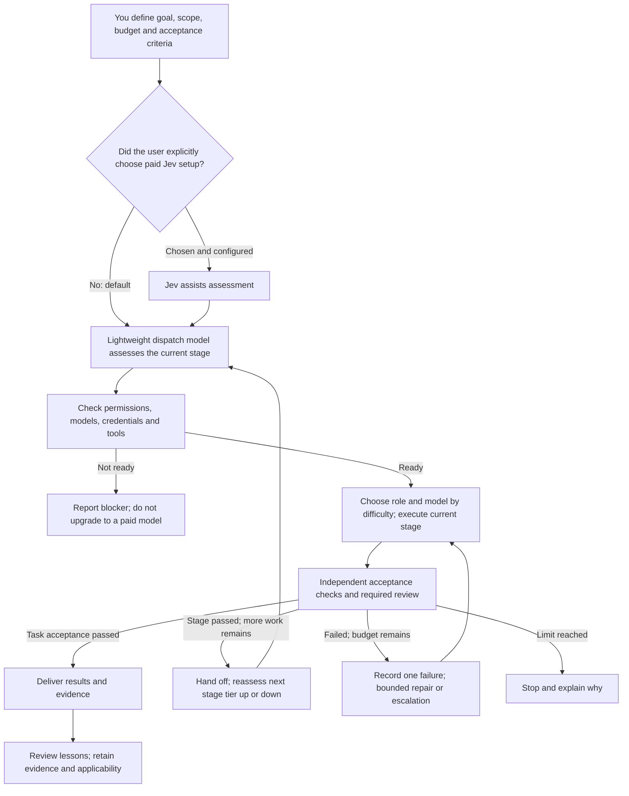
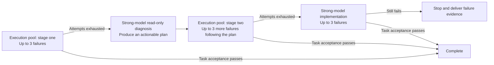

# AI teamwork workflow: free first, upgrade as needed, verify independently

**语言 / Language:** [简体中文](../../README.md) | **English** | [日本語](../ja/README.md) | [Español](../es/README.md) | [Français](../fr/README.md) | [Português (Brasil)](../pt-BR/README.md)

**Choose a model capable enough for the current task. Upgrade for difficult problems, return to a suitable lower tier afterward, and judge the result using actual checks.**

This installation, configuration and usage guide is for beginners and AI Agents. You provide the goal, accounts and authorization; your Agent uses this guide to configure your own computer. Reuse existing tools and environments first.

> **Start here**
> - 🟢 Jev is optional. By default, a lightweight model handles dispatch decisions. Explicitly request Jev if you want it; its API is paid.
> - 🟠 Free allowances may have time and usage limits. Paid fallback needs prior authorization.
> - 🔴 A model saying “done” does not mean acceptance checks passed.
> - This repository contains documentation, not an installer. “Hand it to your AI” means copying a setup task, not automatically changing your computer by clicking a webpage.

<a id="agent-quick-start"></a>

## Hand it to your own AI

**Click the copy icon (⧉ / Copy) at the top right of the block below, paste the entire instruction into your Agent application, and send it.**

You do not need to download or clone the repository first: both document URLs are included. Use an Agent that can read webpages and is authorized to operate your computer. Complete account login, verification codes and required human approvals yourself.

```text
Read the two documents in this public repository and configure my own AI teamwork workflow in my current application and on my computer.
Repository: https://github.com/greyano12syp-a11y/ai-workflow-guide
Workflow specification: https://github.com/greyano12syp-a11y/ai-workflow-guide/blob/main/docs/en/README.md
Execution steps: https://github.com/greyano12syp-a11y/ai-workflow-guide/blob/main/docs/en/AI_SETUP.md
Read both documents completely. Treat README.md as the specification and follow AI_SETUP.md for local inspection, necessary installation, configuration and acceptance checks.
Adapt to my operating system, application capabilities, existing tools and account permissions. Use my workspace and credentials; do not copy the author's paths or accounts.
If this application cannot retrieve the documents online or operate my computer, explain the limits and the steps I must take. Do not claim configuration is complete.
Reuse the existing environment first, back up configurations before changing them, and modify only what this task requires.
By default, use a lightweight model in the dispatch role to assess tasks and let the orchestrator assign work. Do not proactively call Jev for classification. Integrate Jev only if I explicitly request it and authorize the cost.
Use paid services or plan allowances only within my existing explicit authorization. Ask if the scope is unclear. Unauthorized channels must not enter the automatic fallback pool.
I will enter secrets interactively on my computer. Do not put them in chat, command arguments or logs. I will complete login, verification codes and genuine human approvals.
Check model names and reasoning levels against README.md. Report missing models, credentials, tools or permissions as blockers; do not silently substitute them.
Do not treat the documented workflow as already implemented. If the existing orchestrator cannot enforce failure counts, timeouts, permissions or candidate-bound acceptance checks, explain the gap instead of building a complex new system without authorization.
Deliver the configuration changes, rollback instructions and actual acceptance results. Distinguish configuration completed, request succeeded and task completed.
```

Your Agent can then work within your environment, account permissions and authorization. A chat-only application can first read the documents and provide instructions. Actual completion depends on configuration differences and acceptance results.

## Distinguish the website, project page and local API

| What you want to do | Correct destination | How to use it |
| --- | --- | --- |
| Learn about Magpie and find product information and downloads | **[Magpie website](https://usemagpie.ai/)** | Open in a browser |
| View source code, releases and issues | **[Official Magpie GitHub project](https://github.com/yetone/magpie)** | Open in a browser |
| Connect Codex to local Magpie | `http://127.0.0.1:3425/v1` | **Set the application's `base_url`; this is an API, not a website** |
| Use the installed local management interface | Magpie application | Open the application itself |

**`127.0.0.1` refers to the visitor's own computer.** Copying it will not connect someone else to the author's computer. `/v1` is an API path prefix; a browser showing no webpage does not prove the gateway is broken.

This local address is shown only as a configuration value. It is neither the official website nor a public sharing link.

## 1. Understand the small team

| Role | Responsibility |
| --- | --- |
| You | Goal, permitted changes, cost ceiling and acceptance criteria |
| Dispatcher | Use a lightweight model to assess the current stage's capabilities and tool needs; the orchestrator assigns roles and models |
| Planner | Plan strategy and execution for complex work, define responsibilities, then hand off |
| Executor | Read, organize, modify or run checks within a clearly defined scope |
| Verifier | Check results using predetermined checks and any required independent review |

Roles represent responsibilities; model tiers rise or fall with the current stage's difficulty. For complex work, Astra plans strategy and execution, then hands off to lightweight dispatch and low-cost execution models. Small tasks enter the lightweight workflow directly. Do not repeat discovery when files and acceptance criteria are already known. Parallelize only work that can progress independently without competing for files or state.



Jev's advice cannot grant permission. Taking over dispatch decisions or changing tiers cannot bypass a risk rejection or human approval.

<a id="jev-option"></a>

## 2. Optional: Jev decision support

**Jev is a paid option. Explicitly tell your Agent if you want it configured. Otherwise, a lightweight dispatch model assesses tasks; Jev classification is not automatically integrated or called.**

**What it does:** Jev is TypeSafe's decision model. It can select from options (Choice), score against criteria (Score), or estimate the probability that a condition holds (Noul), returning structured results for software. See the [official primitives documentation](https://docs.typesafe.ai/primitives).

**How this workflow uses it:** Send an authorized, concise task summary to Jev, mainly using Choice to help select a capability tier and assess risk. The dispatcher/orchestrator assigns roles and models as below. Jev itself does not write code, operate tools or replace independent acceptance checks.

See [optional Jev integration](AI_SETUP.md#jev-setup). Billing depends on your account; overall savings are not guaranteed. Send only authorized concise summaries and keep credentials in secure local configuration.

<a id="tier-assignment"></a>

### Task tiers and assignments

By default, the existing `group/free-basic` provides lightweight classification. The orchestrator selects the lowest sufficient role and model for the current stage, considering tools, permissions and acceptance requirements. **Roles describe responsibilities, tiers describe capability needs, and task type determines whether writing is allowed.** Hand major plans to low-cost models for execution. Escalate when difficulties arise, then lower the tier after resolving them or entering a simple subtask. Tier changes do not reset failure counts for the same task/counting stage.

| Tier | Suitable tasks and examples | Role and model | Execution arrangement |
| --- | --- | --- | --- |
| **L1 · LIGHT** | Known-file lookup, short summaries, fully specified mechanical edits | Plain-text tasks: **`group/free-basic`**. File tools: **Scout** for read-only discovery, **Operator** for authorized mechanical edits; both use `group/codex-exec-max` / MAX | Lightweight assessment selects the tier; the orchestrator assigns work to the relevant model or pool. Operator may change only specified files; escalate substantive design decisions |
| **L2 · STANDARD** | Scoped implementation, routine bug fixes, research analysis or code review | **Coder**: `group/codex-exec-max` / MAX. Read-only analysis, routine diagnosis or review: **Analyst**, `gpt-6.1-sol` / High | Coder implements within scope. Analyst supplies analysis or repair plans without changing files. Independently verify delivery against predetermined criteria |
| **L3 · DEEP** | Major planning, strategy and execution design, cross-module architecture, difficult diagnosis | **Architect**: `gpt-6-astra` / Xhigh; read-only planning and diagnosis | Define tasks, roles, dependencies, allowed scope and acceptance, then hand off to lightweight dispatch and low-cost execution. Astra does not keep performing routine dispatch. An authorized **Astra Executor** implements only after escalation criteria are met |
| **L4 · HUMAN_GATE** | Irreversible actions or permissions/risks requiring a human decision | **Ask the user**, with no automatic assignment of a writing role | Pause the affected action and explain its impact. After authorization, reassess scope and executable tier. L4 is a human gate, not a more expensive model |

Pool priority is **WorkBuddy DeepSeek → Cloudflare Qwen → authorized Luna fallback**; exact IDs follow. Routine escalation uses **Analyst / Sol High** for diagnosis and **Sol Executor / Sol High** for implementation. Difficult work uses **Architect / Astra Xhigh** and **Astra Executor / Astra Xhigh**, respectively.

Implementation failures follow **3 pool attempts → strong-model read-only diagnosis → 3 more pool attempts → up to 3 strong-model implementation attempts**. Finish only after task-level acceptance and required review pass; planning or diagnosis alone does not complete implementation. Unavailable models, channels or permissions are blockers; tier escalation cannot create permissions or cost authorization.

## 3. Tools and original model configuration

The following is a **reference snapshot dated 2026-10-26**, not a claim that these versions will always be current. Model access and free allowances may differ between accounts.

| Tool | Reference version | Purpose |
| --- | --- | --- |
| [Codex](https://github.com/openai/codex) | `0.163.0` | Agent runtime, role execution and tool calls |
| [Magpie](https://github.com/yetone/magpie) | `0.1.1453` | Model channels, groups and fallback |
| [FastCtx](https://github.com/yc-duan/fastctx) | `0.2.5` | Local reading, search and command execution |

Codex's gateway provider is `magpie`, with `wire_api` set to `responses` and `base_url` set to `http://127.0.0.1:3425/v1`. Bind execution roles separately while preserving the user's existing session settings.

### Free-first execution pool

The execution layer uses the **free-first pool** named `codex-exec-max`, called as **`group/codex-exec-max`**.

**This ID is a custom routing group, not a model or a separately billed service.** The models below do the work; cost depends on the actual channel and account. Routing is `order`, with `turn` affinity: select available sources in order and fall back. This does not automatically compare live prices.

| Order | Exact member ID | Role |
| --- | --- | --- |
| 1 | `workbuddy-ai/deepseek-v4.1-flash:max` | Preferred executor |
| 2 | `cloudflare-ai/@cf/qwen/qwen3.8-27b:xhigh` | Second execution source |
| 3 | `codex/gpt-6-luna:max` | Low-cost fallback; authorize allowance or cost first |

WorkBuddy uses `@magpie-community/opencode-workbuddy-auth@0.1.34`; sign in to your own `workbuddy-ai` account. Cloudflare uses your own account ID and token.

Execution roles use MAX; each member uses its listed level. The Cloudflare member actually uses Xhigh: outer MAX does not mean every upstream supports an identically named parameter.

### Basic short-task pool

Group: `free-basic`; call ID: **`group/free-basic`**. It also uses `order` and `turn`:

1. `groq/openai/gpt-oss-20b:high`
2. `deepseek-2/deepseek-flash:max`

Use it for lightweight classification, field extraction and short summaries. Groq uses Chat Completions. Small free allowances suit small tasks; a large advertised context window does not imply enough free quota for long Agent runs.

### Role models and permissions

| Role | Model / reasoning level | Responsibility and permissions |
| --- | --- | --- |
| Task assessment | `group/free-basic` / member settings | Lightweight classification advice; the orchestrator dispatches |
| Scout | Free-first pool: `group/codex-exec-max` / `max` | Read-only discovery |
| Operator | Free-first pool: `group/codex-exec-max` / `max` | Explicitly scoped, authorized operations |
| Coder | Free-first pool: `group/codex-exec-max` / `max` | Authorized coding and fixes |
| Analyst | `gpt-6.1-sol` / `high` | Read-only diagnosis of routine problems |
| Architect | `gpt-6-astra` / `xhigh` | Read-only major planning, strategy, execution design or difficult diagnosis; hand off afterward |
| Sol Executor | `gpt-6.1-sol` / `high` | Authorized strong-model implementation |
| Astra Executor | `gpt-6-astra` / `xhigh` | Implementation after difficult-task escalation |

See [task tiers and assignments](#tier-assignment) for selection, task types and escalation.

Separate read-only diagnosis from writing. Handoffs include only the goal, necessary material, allowed scope and acceptance requirements.

<details>
<summary>Original top-level smart group and Kimi review channels</summary>

The original top-level smart group uses `group/free-basic` as classifier, `codex/gpt-6-astra:xhigh` for planning, `group/codex-exec-max` for execution and `group/auto-kimi-k3` for review.

The Kimi automatic group may also appear as `auto/kimi-k3`. The original configuration involved `moonshot-cn/kimi-k3`, `opencode-go/kimi-k3` and `moonshot/kimi-k3`; actual members depend on your account.

When using the top-level group, let it select a branch. Already-assigned roles call their bound model or pool directly, without classifying again. Check automatically generated groups for actual members and cost authorization. Fallback within a group does not complete planning, implementation and review; Kimi's opinion cannot replace independent acceptance checks.

</details>

## 4. Control cost before enabling automatic fallback

Before running, define allowed channels, accounts, quota ceilings and what to do when they are exhausted. **Unauthorized channels must not remain in automatically callable lists; enable them in the reference order only after authorization.** Enforce limits in configuration or the invocation entry point, not just in a prompt.

Free allowances may be **limited by time, volume, region or account** and are not guaranteed forever. The same endpoint may be paid for another account.

When quota runs out, evaluate and configure another source yourself, or use a low-cost paid fallback after explicit cost authorization if you prefer less maintenance. Exhausting free quota does not create permission to spend. Session calls, strong models, Luna and some Kimi channels may incur fees or consume plan allowances.

This repository does not name, link to, expose endpoints for or endorse personal free-API aggregation sites. Before adding a source, reassess data-sharing scope, permissions, reliability and cost.

## 5. Counting failures and escalating

Separate prerequisite blockers and channel failures from capability failures first.

| Situation | Handling |
| --- | --- |
| Missing credentials/models, insufficient permission or unavailable required tools | Report the blocker and stop; do not consume capability attempts or automatically upgrade to a paid model |
| Network error, 429 or exhausted quota | Record separately and apply preset limits; no endless retries |
| A complete delivery fails independent acceptance or required review | Count one capability failure |
| No valid delivery or invalid format after excluding the blockers/channel failures above | Count one capability failure |
| Both tests and review fail for the same delivery | Still count only one |
| Resubmission after a fix | A new implementation attempt |
| Switching channels within a group, self-checks or one tool call | Do not count as a separate capability failure |

The entire execution pool shares the count in each stage; each model does not get three attempts of its own. Resuming the same stage or switching models does not reset the count.



Use Sol High for routine diagnosis and Astra Xhigh for difficult diagnosis. Strong-model implementation requires an authorized writing role. Stop if diagnosis yields no actionable plan or the next stage lacks permission, models or budget. Any limit can stop the workflow early; attempts need not all be used.

**Common time and step limits:**

- At most three implementation attempts per counting stage.
- Each model dispatch and its tool execution: at most **600 seconds**.
- Each independent acceptance run has a separate **120-second** limit.
- At most **21 role dispatches**, including implementation, retries, diagnosis and review. Individual tool calls are not separate steps.
- The 21-step limit does not increase the 3+3+3 implementation allowance. Stop when any attempt, time or budget limit is reached.

Preserve failure evidence and existing work; continue from those results. Real mechanisms must enforce counts, timeouts, permissions and budgets. Prompt declarations do not replace verification.

## 6. What “complete” means

**Passing a stage handoff only permits the next stage. Completion requires the deliverable for the user's goal to pass task-level acceptance and required review.** A satisfactory diagnostic plan does not complete an implementation task.

Acceptance and review must refer to the same candidate. After changes, rerun affected checks and required review rather than reusing obsolete pass results.

| What the receiving Agent should deliver | How to assess it |
| --- | --- |
| Role configuration | Exact models, levels, permissions and actual loaded state agree |
| Callable dispatch entry point | Calls the appropriate role or model group for the task |
| Failure records | Bound to the task and counting stage; model changes do not reset counts |
| Timeouts and permission/budget limits | Actually enforced, with an explicit stop at the limit |
| Independent acceptance and required review results | Match the current candidate and caller-selected criteria |
| Blocker reporting and rollback | Clearly report missing models, credentials, tools or authorization; configuration can be restored |

Record “configuration complete,” “request returned” and “task acceptance passed” separately. HTTP 200, exit code 0 and a model's completion claim are not task acceptance. Mark the final model as “unverified” without reliable identity evidence. Unknown usage is not zero. Do not silently substitute a missing model and claim an exact reproduction.

## 7. Start with a small task

> Fix an addition function so its four existing tests pass. Modify only the implementation file; do not change tests.

First reproduce the failure. Give the executor explicit scope and an acceptance command, then use an independent checking process to verify the original tests and protected files. Report actual calls, results and unknown usage on success; otherwise record and escalate under the rules above.

Run small read-only and editing tasks before adding complex assignments. GitHub Queue is an optional intake and queueing entry point; it follows the same authorization and acceptance chain. An Issue body cannot grant writing permission or cost authorization.

## 8. Magpie redaction and access protection

Before publishing configurations, screenshots, logs or backups:

- Replace API keys, tokens, Cookies, OAuth credentials and authorization headers with placeholders.
- Remove account information, personal email, private repository URLs, private paths and account identifiers embedded in URLs.
- Do not publish full chats, raw request/response logs, authentication caches or unreviewed configuration exports/backups.
- If using Magpie's redaction feature, follow the installed version's official instructions and test with synthetic samples. A feature name does not prove all sensitive data is protected.

**Verify that the gateway actually listens only on a local address such as `127.0.0.1`. A client configured with localhost does not prove the server is not externally exposed.** Do not enable public/LAN sharing, port forwarding or an unauthenticated proxy by default. If remote access is needed, configure authentication, encrypted connections and access restrictions separately.

Use trusted tools and plugins. Restrict access to credential files and keep them out of public repositories and uncontrolled shared folders.

**Redaction reduces disclosure risk; it does not guarantee protection against intrusion.** Revoke or rotate exposed credentials and review access records. Removing public text alone does not resolve a leak.

## 9. Evidence and lessons learned

As of 2026-10-26, the original project's records cover real CLI tool calls on Windows, small code fixes using the free pool, basic classification/extraction/summarization and isolated read-only queues. They do not guarantee success with other accounts or environments.

There is no complete project bill or rigorous cost comparison that supports fixed savings claims. This guide promises neither permanent free access, a fixed saving percentage nor faster execution for every task. Validate the additional execution rules individually in your own environment.

Record methods, evidence, applicable conditions and failure cases afterward. Treat lessons as candidates, without automatically changing global rules. A previous task's PASS does not prove a new task passed.

---

**Execution order and completion conditions for AI:** [AI_SETUP.md](AI_SETUP.md)

This page uses GitHub-supported Mermaid diagrams and Markdown tables without a custom website service. See [GitHub's diagram documentation](https://docs.github.com/en/get-started/writing-on-github/working-with-advanced-formatting/creating-diagrams).

---

<a id="support"></a>

## Optional support

Developing, testing and documenting this AI teamwork workflow took about two months and involved substantial out-of-pocket costs. If this guide helps you, voluntary support is welcome for further testing, documentation and maintenance.

**Support is entirely optional, with no required amount. All public repository content remains free to access and use whether or not you contribute.**

WeChat Pay, Alipay and Payoneer collection codes are below. Click an image to view the original. Thank you for your support!

<p align="center">
  <a href="../../assets/support/wechat-pay.png"></a>
  <a href="../../assets/support/alipay.jpg"></a>
  <a href="../../assets/support/payoneer.png"></a>
</p>
