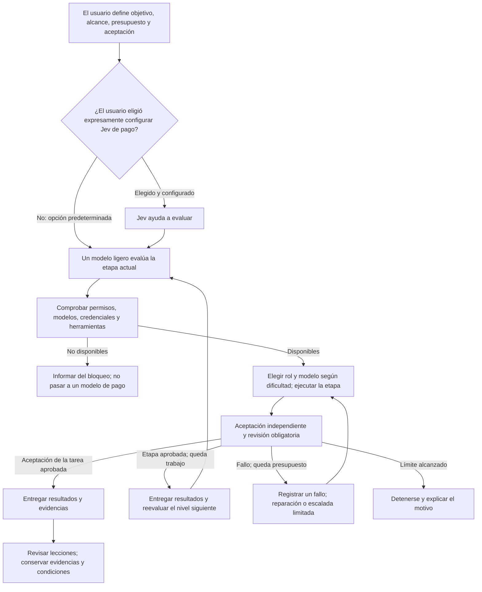
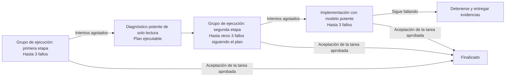

# Flujo de trabajo con IA: priorizar lo gratuito, escalar cuando haga falta y verificar de forma independiente

**语言 / Language:** [简体中文](../../README.md) | [English](../en/README.md) | [日本語](../ja/README.md) | **Español** | [Français](../fr/README.md) | [Português (Brasil)](../pt-BR/README.md)

**Elige un modelo suficiente para la tarea actual. Usa uno más capaz ante problemas difíciles, vuelve a un nivel adecuado cuando se resuelvan y evalúa el resultado mediante comprobaciones reales.**

Guía de instalación, configuración y uso para principiantes y agentes de IA. Tú aportas objetivos, cuentas y autorización; tu agente configura tu ordenador siguiendo esta guía. Reutiliza primero las herramientas y el entorno existentes.

> **Antes de empezar**
> - 🟢 Jev es opcional. Por defecto, un modelo ligero toma las decisiones de asignación. Solicita Jev expresamente si lo quieres: su API es de pago.
> - 🟠 Las cuotas gratuitas pueden tener límites de tiempo y uso. Una alternativa de pago requiere autorización previa.
> - 🔴 Que el modelo diga «terminado» no significa que haya superado la aceptación.
> - Este repositorio contiene documentación, no un instalador. «Encárgaselo a tu IA» significa copiar una tarea de configuración; pulsar una página no modifica automáticamente tu ordenador.

<a id="agent-quick-start"></a>

## Encárgaselo a tu propia IA

**Pulsa el icono de copiar (⧉ / Copy) en la esquina superior derecha del bloque y envía la instrucción completa en tu aplicación de agentes.**

No necesitas descargar ni clonar antes el repositorio: se incluyen las direcciones completas de ambos documentos. Utiliza un agente capaz de leer páginas web y autorizado para operar tu ordenador. Tú debes completar los inicios de sesión, códigos de verificación y aprobaciones humanas necesarias.

```text
Lee los dos documentos de este repositorio público y configura mi propio flujo de trabajo con IA en mi aplicación actual y en mi ordenador.
Repositorio: https://github.com/greyano12syp-a11y/ai-workflow-guide
Especificación: https://github.com/greyano12syp-a11y/ai-workflow-guide/blob/main/docs/es/README.md
Pasos de ejecución: https://github.com/greyano12syp-a11y/ai-workflow-guide/blob/main/docs/es/AI_SETUP.md
Lee ambos documentos completos. Usa README.md como especificación y sigue AI_SETUP.md para inspeccionar el equipo, instalar lo necesario, configurar y verificar la aceptación.
Adapta la configuración a mi sistema operativo, aplicación, herramientas y permisos. Usa mi directorio de trabajo y mis credenciales, no las rutas ni las cuentas del autor.
Si la aplicación no puede leer los documentos en línea u operar mi ordenador, explica sus límites y los pasos que debo realizar. No afirmes que la configuración está terminada.
Reutiliza el entorno existente, respalda los archivos de configuración antes de modificarlos y cambia únicamente lo necesario.
Por defecto, un modelo ligero en el rol de asignación evalúa las tareas y el orquestador reparte el trabajo. No llames a Jev para clasificar por iniciativa propia. Intégralo solo si lo solicito expresamente y autorizo el coste.
Usa servicios de pago o cuotas de planes únicamente dentro de mi autorización explícita vigente. Pregunta si no está clara; los canales no autorizados no deben entrar en el grupo de alternativas automáticas.
Yo introduciré las claves de forma interactiva en mi ordenador. No las incluyas en el chat, argumentos de comandos ni registros. Yo completaré los inicios de sesión, códigos y aprobaciones humanas reales.
Comprueba los nombres de modelos y niveles de razonamiento con README.md. Informa de modelos, credenciales, herramientas o permisos faltantes; no los sustituyas en silencio.
No consideres implementado el flujo solo porque esté documentado. Si el orquestador existente no aplica los contadores de fallos, tiempos límite, permisos o aceptación vinculada al candidato, explica la carencia sin desarrollar un sistema complejo nuevo sin autorización.
Entrega los cambios, cómo revertirlos y los resultados reales de aceptación. Distingue configuración completada, solicitud correcta y tarea completada.
```

El agente trabajará según tu entorno, permisos y autorización. Una aplicación solo de chat puede leer los documentos y ofrecer instrucciones. La finalización real se determina mediante los cambios de configuración y las pruebas de aceptación.

## Distingue sitio web, proyecto y API local

| Objetivo | Entrada correcta | Uso |
| --- | --- | --- |
| Conocer Magpie y encontrar información y descargas | **[Sitio de Magpie](https://usemagpie.ai/)** | Abrir en el navegador |
| Ver código, versiones e incidencias | **[Proyecto oficial de Magpie](https://github.com/yetone/magpie)** | Abrir en el navegador |
| Conectar Codex a Magpie local | `http://127.0.0.1:3425/v1` | **Configurar como `base_url`; es una API, no una página web** |
| Usar la interfaz local instalada | Aplicación Magpie | Entrar desde la propia aplicación |

**`127.0.0.1` representa el ordenador de quien accede.** Copiar esta dirección no conecta con el equipo del autor. `/v1` es un prefijo de API; que el navegador no muestre una página no demuestra un fallo de la pasarela.

La dirección local aparece solo como valor de configuración, no como sitio oficial ni enlace público.

## 1. Conoce al pequeño equipo

| Rol | Responsabilidad |
| --- | --- |
| Tú | Objetivo, cambios permitidos, presupuesto máximo y criterios de aceptación |
| Coordinador de asignación | Evaluar capacidades y herramientas de la etapa con un modelo ligero; el orquestador asigna roles y modelos |
| Planificador | Diseñar estrategia, planificación y despliegue de ejecución para tareas complejas; definir responsabilidades y entregar el plan |
| Ejecutor | Leer, organizar, modificar o comprobar dentro de un alcance explícito |
| Verificador | Contrastar resultados con comprobaciones previstas y la revisión independiente requerida |

Los roles definen responsabilidades; el nivel del modelo cambia con la dificultad de cada etapa. Astra planifica la estrategia y la ejecución de trabajos complejos y después entrega el trabajo a la coordinación ligera y a modelos de bajo coste. Las tareas pequeñas entran directamente en el flujo ligero. No repitas la exploración si ya se conocen archivos y criterios. Paraleliza solo tareas independientes que no compitan por archivos o estado.



El consejo de Jev no concede permisos. Asumir la decisión o cambiar el nivel tampoco permite eludir un rechazo por riesgo o una aprobación humana.

<a id="jev-option"></a>

## 2. Opción: apoyo a decisiones con Jev

**Jev es de pago. Pide expresamente a tu agente que lo configure si lo deseas. Sin esa solicitud, un modelo ligero evalúa las tareas y no se integra ni se llama automáticamente a Jev para clasificar.**

**Qué hace:** Jev es el modelo de decisión de TypeSafe. Selecciona opciones (Choice), puntúa según criterios (Score) o estima la probabilidad de una condición (Noul), devolviendo resultados estructurados. Consulta la [documentación oficial](https://docs.typesafe.ai/primitives).

**Uso en este flujo:** enviar un resumen breve autorizado, principalmente para que Choice ayude a elegir el nivel de capacidad y a identificar riesgos. El coordinador/orquestador asigna roles y modelos según la tabla. Jev no programa, no opera herramientas ni reemplaza la aceptación independiente.

Consulta la [integración opcional de Jev](AI_SETUP.md#jev-setup). Se aplica la facturación de tu cuenta y no se garantizan ahorros totales. Solo se envían resúmenes breves autorizados; las claves permanecen en configuración local segura.

<a id="tier-assignment"></a>

### Niveles y asignaciones

Por defecto, `group/free-basic` proporciona clasificación ligera. El orquestador elige el rol y modelo mínimos suficientes para la etapa según herramientas, permisos y aceptación. **El rol define responsabilidades; el nivel, la capacidad necesaria; el tipo de tarea, si se permite escribir.** Tras planificar, entrega la ejecución a modelos de bajo coste. Escala ante dificultades y vuelve a bajar al resolverlas o pasar a tareas sencillas. Cambiar de nivel no reinicia los fallos de la misma tarea/etapa de cómputo.

| Nivel | Tareas y ejemplos | Rol y modelo | Organización |
| --- | --- | --- | --- |
| **L1 · LIGHT** | Buscar archivos conocidos, resúmenes breves, cambios mecánicos completamente definidos | Texto: **`group/free-basic`**. Archivos: **Scout** para explorar en solo lectura y **Operator** para cambios autorizados; ambos `group/codex-exec-max` / MAX | Evaluación ligera y asignación por el orquestador. Operator cambia solo archivos indicados; las decisiones de diseño sustantivas requieren escalar |
| **L2 · STANDARD** | Implementación acotada, errores habituales, análisis o revisión de código | **Coder**: `group/codex-exec-max` / MAX. Análisis, diagnóstico habitual o revisión de solo lectura: **Analyst**, `gpt-6.1-sol` / High | Coder implementa dentro del alcance; Analyst solo analiza o propone soluciones, sin modificar archivos. Verificación independiente según criterios previos |
| **L3 · DEEP** | Grandes planes, estrategia y ejecución, arquitectura entre módulos, diagnóstico difícil | **Architect**: `gpt-6-astra` / Xhigh, planificación y diagnóstico de solo lectura | Definir tareas, roles, dependencias, alcance y aceptación; entregar a coordinación ligera y ejecución económica. Astra no sigue coordinando el trabajo rutinario. **Astra Executor** autorizado implementa solo al cumplirse las condiciones de escalada |
| **L4 · HUMAN_GATE** | Acciones irreversibles o decisiones humanas sobre permisos/riesgos | **Consultar al usuario**, sin asignar automáticamente un rol con escritura | Pausar la acción, explicar su impacto y redefinir alcance/nivel tras autorización. L4 es un control humano, no un modelo más caro |

Prioridad del grupo: **WorkBuddy DeepSeek → Cloudflare Qwen → Luna de respaldo autorizado**. Los ID exactos están en la siguiente sección. En casos habituales, **Analyst / Sol High** diagnostica y **Sol Executor / Sol High** implementa; en casos difíciles, **Architect / Astra Xhigh** y **Astra Executor / Astra Xhigh**.

Los fallos siguen **3 intentos del grupo → diagnóstico de solo lectura con modelo potente → otros 3 intentos del grupo → hasta 3 intentos de implementación con modelo potente**. Solo termina al superar la aceptación de la tarea y la revisión requerida. Aprobar planificación o diagnóstico no completa la implementación. La falta de modelos, canales o permisos bloquea; escalar no concede permisos ni presupuesto.

## 3. Herramientas y configuración original de modelos

Esta es una **referencia del 2026-10-26**, no una afirmación de que las versiones sean siempre las últimas. El acceso y las políticas gratuitas pueden variar por cuenta.

| Herramienta | Versión de referencia | Uso |
| --- | --- | --- |
| [Codex](https://github.com/openai/codex) | `0.163.0` | Entorno de agentes, roles y herramientas |
| [Magpie](https://github.com/yetone/magpie) | `0.1.1453` | Canales, grupos y alternativas de modelos |
| [FastCtx](https://github.com/yc-duan/fastctx) | `0.2.5` | Lectura, búsqueda y comandos locales |

El provider de la pasarela en Codex es `magpie`, con `wire_api` = `responses` y `base_url` = `http://127.0.0.1:3425/v1`. Asigna modelos a los roles por separado y conserva los ajustes de sesión existentes.

### Grupo de ejecución que prioriza lo gratuito

Nombre: `codex-exec-max`; ID de llamada: **`group/codex-exec-max`**.

**Este ID identifica un grupo de enrutamiento personalizado, no un modelo ni un servicio facturado por separado.** Ejecutan los modelos siguientes y el coste depende del canal real y de la cuenta. Se usa enrutamiento `order` y afinidad `turn`: seleccionar fuentes disponibles en orden y recurrir a alternativas. No compara precios en tiempo real.

| Orden | ID exacto | Función |
| --- | --- | --- |
| 1 | `workbuddy-ai/deepseek-v4.1-flash:max` | Ejecución preferente |
| 2 | `cloudflare-ai/@cf/qwen/qwen3.8-27b:xhigh` | Segunda fuente |
| 3 | `codex/gpt-6-luna:max` | Alternativa económica, previa autorización de cuota o coste |

WorkBuddy usa `@magpie-community/opencode-workbuddy-auth@0.1.34` y tu propia cuenta `workbuddy-ai`. Cloudflare usa tu propio ID de cuenta y token.

Los roles de ejecución se configuran en MAX, pero cada miembro usa el nivel de la tabla. Cloudflare utiliza Xhigh; el MAX externo no implica que todos los proveedores admitan ese mismo parámetro.

### Grupo básico para tareas cortas

Nombre: `free-basic`; ID: **`group/free-basic`**. También usa `order` y `turn`:

1. `groq/openai/gpt-oss-20b:high`
2. `deepseek-2/deepseek-flash:max`

Para clasificación ligera, extracción de campos y resúmenes breves. Groq usa Chat Completions. Una cuota gratuita pequeña sirve para tareas pequeñas; un contexto anunciado grande no garantiza cuota suficiente para largas ejecuciones de agentes.

### Modelos y permisos de cada rol

| Rol | Modelo / razonamiento | Responsabilidad y permisos |
| --- | --- | --- |
| Evaluación | `group/free-basic` / ajustes de cada miembro | Recomendar clasificación; el orquestador asigna |
| Scout | Grupo gratuito prioritario: `group/codex-exec-max` / `max` | Exploración de solo lectura |
| Operator | Grupo gratuito prioritario: `group/codex-exec-max` / `max` | Operaciones explícitas autorizadas |
| Coder | Grupo gratuito prioritario: `group/codex-exec-max` / `max` | Programación y correcciones autorizadas |
| Analyst | `gpt-6.1-sol` / `high` | Diagnóstico rutinario de solo lectura |
| Architect | `gpt-6-astra` / `xhigh` | Planificación, estrategia, diseño de ejecución o diagnóstico difícil de solo lectura; después entrega el trabajo |
| Sol Executor | `gpt-6.1-sol` / `high` | Implementación autorizada con modelo potente |
| Astra Executor | `gpt-6-astra` / `xhigh` | Implementación tras escalar una tarea difícil |

Consulta [niveles y asignaciones](#tier-assignment). Separa diagnóstico de solo lectura e implementación con escritura. El traspaso contiene solo objetivo, material necesario, alcance autorizado y aceptación.

<details>
<summary>Grupo inteligente superior original y canales de revisión Kimi</summary>

El clasificador del grupo superior es `group/free-basic`; planificación: `codex/gpt-6-astra:xhigh`; ejecución: `group/codex-exec-max`; revisión: `group/auto-kimi-k3`.

El grupo automático de Kimi también puede aparecer como `auto/kimi-k3`. La configuración original incluía `moonshot-cn/kimi-k3`, `opencode-go/kimi-k3` y `moonshot/kimi-k3`; los miembros reales dependen de la cuenta.

Si usas el grupo superior, deja que elija la rama. Si el rol ya está asignado, llama directamente a su modelo o grupo sin volver a clasificar. Comprueba miembros reales y autorización de costes incluso en grupos generados automáticamente. Cambiar de fuente dentro de un grupo no completa planificación, implementación y revisión; la opinión de Kimi no sustituye la aceptación independiente.

</details>

## 4. Controla el coste antes de habilitar alternativas automáticas

Define canales, cuentas, cuotas máximas y actuación al agotarlas. **Los canales no autorizados no deben permanecer en listas invocables automáticamente; actívalos en el orden indicado solo tras autorización.** Aplica los límites en configuración o en el punto de llamada, no solo mediante un prompt.

Las cuotas gratuitas pueden estar **limitadas por tiempo, cantidad, región o cuenta** y no se garantizan para siempre. La misma API puede ser de pago en otra cuenta.

Al agotarlas, puedes evaluar y configurar otra fuente, o autorizar expresamente una alternativa económica de pago si prefieres menos mantenimiento. Agotar la cuota gratuita no crea autorización para gastar. Las llamadas de sesión, modelos potentes, Luna y algunos canales Kimi pueden cobrar o consumir cuotas del plan.

Este repositorio no proporciona nombres, enlaces ni API de sitios personales que agregan API gratuitas, ni los respalda. Antes de añadir fuentes, revisa datos enviados, permisos, fiabilidad y costes.

## 5. Cómo contar fallos y escalar

Primero separa los bloqueos previos y fallos de canal de los fallos de capacidad.

| Situación | Tratamiento |
| --- | --- |
| Faltan credenciales, modelos, permisos o herramientas necesarias | Informar y detenerse; no descontar intentos de capacidad ni pasar automáticamente a modelos de pago |
| Error de red, 429 o cuota agotada | Registrar aparte y respetar límites de reintento; nunca reintentar indefinidamente |
| Una entrega completa no supera aceptación independiente o revisión requerida | Un fallo de capacidad |
| Sin entrega válida o con formato incorrecto, tras excluir los bloqueos/fallos de canal anteriores | Un fallo de capacidad |
| Pruebas y revisión fallan para la misma entrega | Sigue contando como uno |
| Reentrega después de corregir | Nuevo intento de implementación |
| Cambio de canal dentro del grupo, autocomprobación o llamada de herramienta | No cuenta por separado como fallo de capacidad |

Todo el grupo comparte el contador de cada etapa; no hay tres intentos por modelo. Retomar la misma etapa o cambiar de modelo no lo reinicia.



Sol High diagnostica problemas habituales; Astra Xhigh, los difíciles. La implementación potente requiere un rol de escritura autorizado. Detente si no hay plan ejecutable o faltan permisos, modelos o presupuesto para la siguiente etapa. Cualquier límite puede detener el proceso antes; no es necesario agotar todos los intentos.

**Límites comunes de tiempo y pasos:**

- Máximo tres intentos de implementación por etapa de cómputo.
- Cada asignación a un modelo y sus herramientas: **600 segundos** como máximo.
- Cada aceptación independiente tiene un límite separado de **120 segundos**.
- Máximo **21 asignaciones de roles**, incluyendo implementación, reintentos, diagnóstico y revisión. Una llamada de herramienta no añade un paso.
- Los 21 pasos no amplían los 3+3+3 intentos. Detente al alcanzar primero cualquier límite de intentos, tiempo o presupuesto.

Conserva las evidencias de cada fallo y el trabajo existente para continuar desde allí. Los contadores, tiempos, permisos y presupuestos necesitan mecanismos reales; declararlos en un prompt no equivale a verificarlos.

## 6. Qué significa terminar

**Aprobar el traspaso de una etapa solo permite avanzar a la siguiente. La tarea termina cuando el entregable del objetivo del usuario supera la aceptación de la tarea y la revisión requerida.** Un diagnóstico aprobado no completa una implementación.

Aceptación y revisión deben corresponder al mismo candidato. Después de cambiarlo, repite las comprobaciones afectadas y revisiones necesarias; no reutilices aprobaciones obsoletas.

| Entrega del agente receptor | Criterio |
| --- | --- |
| Configuración de roles | Modelos exactos, niveles, permisos y estado realmente cargado coinciden |
| Entrada de asignación invocable | Invoca el rol o grupo adecuado para la tarea |
| Registros de fallos | Vinculados a tarea y etapa; cambiar de modelo no reinicia |
| Tiempos límite y permisos/presupuesto | Aplicados realmente, con parada explícita al alcanzar límites |
| Aceptación independiente y revisión requerida | Del candidato actual, según criterios del solicitante |
| Bloqueos y reversión | Informa de carencias y permite restaurar la configuración |

Registra por separado «configuración completada», «solicitud respondida» y «aceptación aprobada». HTTP 200, código de salida 0 y afirmaciones del modelo no sustituyen la aceptación. Si no hay identificación fiable del modelo final, indica «sin verificar». Uso desconocido no significa cero. No sustituyas modelos faltantes en silencio para afirmar una reproducción exacta.

## 7. Empieza con una tarea pequeña

> Corrige una función de suma para superar sus cuatro pruebas existentes. Modifica solo la implementación, nunca las pruebas.

Reproduce primero el problema, define alcance y comando de aceptación, y usa un proceso independiente para comprobar pruebas originales y archivos protegidos. Informa de llamadas reales, resultados y consumo desconocido; si falla, registra y escala como se indicó.

Completa tareas pequeñas de lectura y edición antes de complicar la organización. GitHub Queue es una entrada opcional de recepción y cola; mantiene la misma cadena de autorización y aceptación. El texto de un Issue no concede permisos de escritura ni de gasto.

## 8. Ocultación de datos sensibles y protección de acceso en Magpie

Antes de publicar configuración, capturas, registros o copias:

- Sustituye API keys, tokens, Cookies, credenciales OAuth y cabeceras de autorización por marcadores.
- Elimina datos de cuentas, correos personales, repositorios privados, rutas privadas e identificadores de cuentas en URL.
- No publiques conversaciones completas, registros brutos de solicitudes/respuestas, cachés de autenticación ni exportaciones/copias sin revisar.
- Si usas la ocultación integrada de Magpie, comprueba sus ajustes con la documentación oficial de esa versión y muestras sintéticas. El nombre de la función no demuestra que proteja todos los datos.

**Comprueba que la pasarela escucha realmente solo en una dirección local, como `127.0.0.1`. Configurar localhost en el cliente no demuestra que el servidor no esté expuesto.** No habilites por defecto acceso público/LAN, reenvío de puertos ni proxies sin autenticación. Para acceso remoto, configura aparte autenticación, cifrado y restricciones.

Usa herramientas y complementos de confianza. Restringe la lectura de credenciales y mantenlas fuera de repositorios públicos y carpetas compartidas sin control.

**Ocultar datos reduce filtraciones, pero no garantiza evitar intrusiones.** Revoca o rota credenciales expuestas y revisa los accesos. Borrar el texto público no resuelve por sí solo una filtración.

## 9. Alcance de las evidencias y lecciones

Hasta el 2026-10-26, los registros del proyecto original incluyen llamadas CLI reales en Windows, pequeñas correcciones con el grupo gratuito, clasificación/extracción/resúmenes básicos y colas aisladas de solo lectura. No garantizan éxito con otras cuentas o entornos.

No hay una factura completa ni una comparación rigurosa de costes que permita prometer un beneficio fijo. La guía no garantiza gratuidad permanente, porcentajes de ahorro ni mayor rapidez en todas las tareas. Verifica cada regla adicional de ejecución en tu entorno.

Registra métodos, evidencias, condiciones y fallos. Las lecciones son propuestas, no cambios automáticos en reglas globales. Un PASS anterior no demuestra el éxito de una nueva tarea.

---

**Orden de ejecución y condiciones de finalización para IA:** [AI_SETUP.md](AI_SETUP.md)

Esta página utiliza Mermaid y tablas Markdown admitidos por GitHub, sin servicio web propio. Consulta la [documentación oficial de diagramas](https://docs.github.com/en/get-started/writing-on-github/working-with-advanced-formatting/creating-diagrams).

---

<a id="support"></a>

## Apoyo voluntario

Desarrollar, probar y documentar este flujo llevó unos dos meses y supuso gastos considerables. Si te resulta útil, puedes apoyar voluntariamente las pruebas, la documentación y el mantenimiento.

**Es totalmente opcional y el importe es libre. Todo el contenido público del repositorio sigue siendo gratuito para acceder y usar, contribuyas o no.**

Códigos de WeChat Pay, Alipay y Payoneer. Pulsa una imagen para verla en su tamaño original. ¡Gracias por tu apoyo!

<p align="center">
  <a href="../../assets/support/wechat-pay.png"></a>
  <a href="../../assets/support/alipay.jpg"></a>
  <a href="../../assets/support/payoneer.png"></a>
</p>
