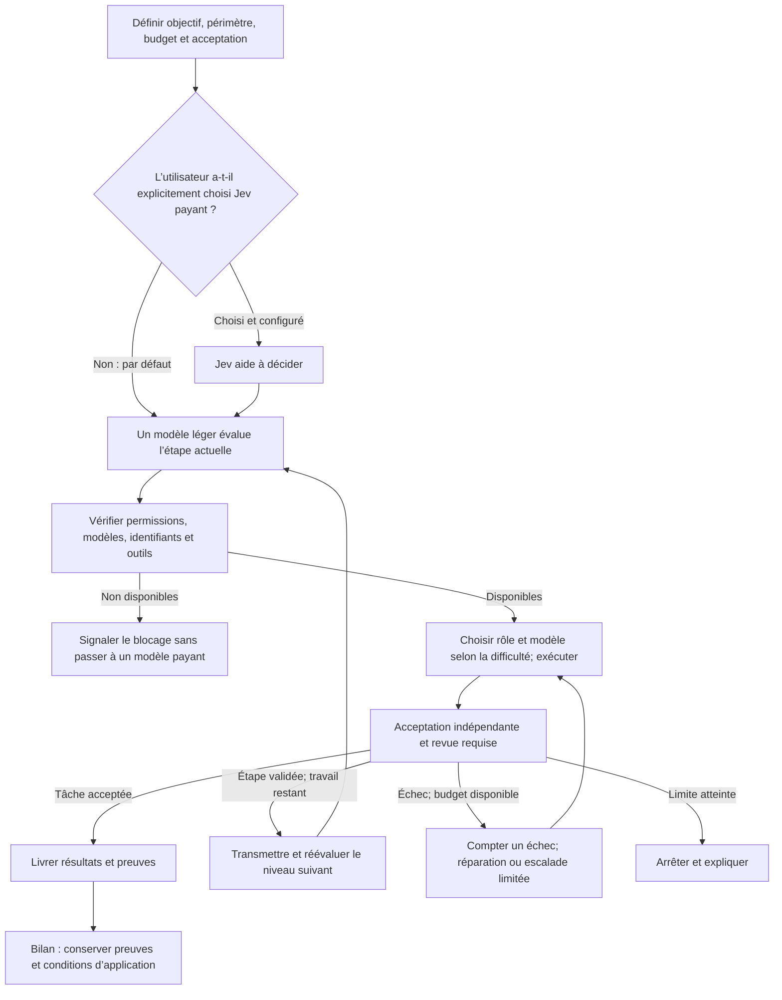
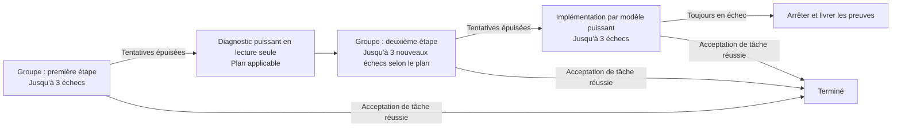

# Travail en équipe avec l’IA : priorité au gratuit, montée en gamme selon le besoin, validation indépendante

**语言 / Language:** [简体中文](../../README.md) | [English](../en/README.md) | [日本語](../ja/README.md) | [Español](../es/README.md) | **Français** | [Português (Brasil)](../pt-BR/README.md)

**Choisissez un modèle suffisamment capable pour la tâche actuelle. Montez en gamme face à une difficulté, redescendez ensuite au niveau adapté et jugez le résultat à partir de vérifications réelles.**

Guide d’installation, de configuration et d’utilisation destiné aux débutants et aux agents IA. Vous fournissez l’objectif, les comptes et les autorisations ; votre agent configure votre ordinateur à partir de ce guide. Réutilisez d’abord les outils et l’environnement existants.

> **À lire d’abord**
> - 🟢 Jev est facultatif. Par défaut, un modèle léger évalue l’affectation des tâches. Demandez explicitement Jev si vous le souhaitez : son API est payante.
> - 🟠 Les quotas gratuits peuvent être limités dans le temps et en volume. Un recours payant exige une autorisation préalable.
> - 🔴 Un modèle qui annonce « terminé » n’a pas nécessairement satisfait aux critères d’acceptation.
> - Ce dépôt contient de la documentation, pas un installateur. « Confier à votre IA » consiste à copier une demande de configuration ; cliquer sur une page ne modifie pas automatiquement votre ordinateur.

<a id="agent-quick-start"></a>

## Confier la configuration à votre propre IA

**Cliquez sur l’icône de copie (⧉ / Copy) en haut à droite du bloc, puis collez et envoyez l’instruction entière dans votre application d’agents.**

Aucun téléchargement ni clonage préalable n’est nécessaire : les URL complètes des deux documents sont incluses. Utilisez un agent capable de lire le Web et autorisé à agir sur votre ordinateur. Effectuez vous-même les connexions, codes de vérification et validations humaines nécessaires.

```text
Lis les deux documents de ce dépôt public et configure mon propre flux de travail avec l’IA dans mon application actuelle et sur mon ordinateur.
Dépôt : https://github.com/greyano12syp-a11y/ai-workflow-guide
Spécification : https://github.com/greyano12syp-a11y/ai-workflow-guide/blob/main/docs/fr/README.md
Étapes d’exécution : https://github.com/greyano12syp-a11y/ai-workflow-guide/blob/main/docs/fr/AI_SETUP.md
Lis les deux documents intégralement. Prends README.md comme spécification et suis AI_SETUP.md pour l’inspection locale, les installations nécessaires, la configuration et la validation.
Adapte-toi à mon système, à mon application, aux outils existants et à mes droits. Utilise mon répertoire de travail et mes identifiants, pas ceux de l’auteur.
Si l’application ne peut pas lire les documents en ligne ou agir sur mon ordinateur, explique ses limites et les étapes qui me reviennent. Ne prétends pas que la configuration est achevée.
Réutilise l’environnement, sauvegarde la configuration avant modification et ne change que ce qui est nécessaire.
Par défaut, un modèle léger dans le rôle d’affectation évalue les tâches et l’orchestrateur distribue le travail. N’appelle pas spontanément Jev pour classifier. Intègre-le uniquement si je le demande expressément et autorise le coût.
L’utilisation payante ou des quotas d’abonnement doit rester dans mon autorisation explicite existante. Demande si elle est ambiguë. Aucun canal non autorisé ne doit entrer dans les solutions de repli automatiques.
Je saisirai les secrets de manière interactive sur mon ordinateur. Ne les écris pas dans la conversation, les arguments de commande ou les journaux. Je réaliserai connexions, codes et véritables approbations humaines.
Vérifie noms de modèles et niveaux de raisonnement dans README.md. Signale les modèles, identifiants, outils ou permissions manquants ; ne les remplace pas silencieusement.
Ne considère pas le processus documenté comme déjà implémenté. Si l’orchestrateur ne peut pas appliquer les compteurs d’échecs, délais, permissions ou validations liées au candidat, explique la lacune sans construire un nouveau système complexe sans autorisation.
Livre les changements, la procédure de retour arrière et les résultats réels de validation. Distingue configuration terminée, requête réussie et tâche terminée.
```

L’agent agit selon votre environnement, vos droits et votre autorisation. Une application de conversation seule peut lire les documents et fournir les étapes. L’achèvement réel se mesure aux différences de configuration et aux résultats d’acceptation.

## Distinguer site officiel, projet et API locale

| Objectif | Bonne entrée | Utilisation |
| --- | --- | --- |
| Découvrir Magpie et ses téléchargements | **[Site officiel Magpie](https://usemagpie.ai/)** | Navigateur |
| Consulter code, versions et problèmes | **[Projet GitHub officiel Magpie](https://github.com/yetone/magpie)** | Navigateur |
| Connecter Codex à Magpie local | `http://127.0.0.1:3425/v1` | **Valeur de `base_url` ; c’est une API, pas un site Web** |
| Utiliser l’interface locale installée | Application Magpie | Ouvrir l’application |

**`127.0.0.1` désigne l’ordinateur de la personne qui y accède.** Copier cette adresse ne connecte pas au poste de l’auteur. `/v1` est un préfixe d’API ; l’absence de page dans le navigateur ne prouve pas une panne de passerelle.

Cette adresse est uniquement une valeur de configuration, pas un site officiel ni un lien de partage public.

## 1. Comprendre la petite équipe

| Rôle | Responsabilité |
| --- | --- |
| Vous | Objectif, modifications permises, plafond de coût et critères d’acceptation |
| Répartiteur | Évaluer capacités et outils de l’étape avec un modèle léger ; l’orchestrateur affecte rôles et modèles |
| Planificateur | Concevoir stratégie, plan global et organisation de l’exécution des tâches complexes, puis transmettre |
| Exécutant | Lire, organiser, modifier ou vérifier dans un périmètre explicite |
| Vérificateur | Contrôler les résultats avec les vérifications prévues et la revue indépendante requise |

Les rôles décrivent les responsabilités ; le niveau des modèles varie avec la difficulté de l’étape. Astra prépare la stratégie et l’exécution des travaux complexes, puis transmet à la répartition légère et aux modèles économiques. Les petites tâches suivent directement le circuit léger. Ne répétez pas l’exploration lorsque fichiers et critères sont connus. Parallélisez uniquement les travaux indépendants sans concurrence sur les fichiers ou l’état.



Un conseil de Jev ne confère pas de permission. Reprendre la décision ou modifier le niveau ne permet pas de contourner un refus lié au risque ou une validation humaine.

<a id="jev-option"></a>

## 2. Option : aide à la décision avec Jev

**Jev est payant. Demandez explicitement sa configuration. Sans demande, un modèle léger évalue les tâches ; la classification Jev n’est ni intégrée ni appelée automatiquement.**

**Fonctions :** Jev est le modèle de décision de TypeSafe. Il choisit parmi des options (Choice), attribue un score selon des critères (Score), ou estime la probabilité d’une condition (Noul), avec un résultat structuré. Voir la [documentation officielle](https://docs.typesafe.ai/primitives).

**Notre usage :** transmettre un bref résumé autorisé, principalement pour aider, via Choice, à déterminer le niveau de capacité et les risques. Le répartiteur/orchestrateur affecte les modèles selon le tableau. Jev ne programme pas, ne manipule pas d’outils et ne remplace pas l’acceptation indépendante.

Voir l’[intégration facultative](AI_SETUP.md#jev-setup). La facturation dépend du compte, sans garantie d’économie globale. N’envoyez que des résumés brefs autorisés ; conservez les clés dans une configuration locale sécurisée.

<a id="tier-assignment"></a>

### Niveaux et responsabilités

Par défaut, `group/free-basic` assure la classification légère. L’orchestrateur choisit le rôle et le modèle les moins puissants qui suffisent, compte tenu des outils, permissions et critères. **Le rôle définit la responsabilité, le niveau définit la capacité nécessaire et le type de tâche détermine le droit d’écriture.** Transmettez les plans aux modèles économiques, montez en gamme devant une difficulté puis redescendez après résolution ou pour une sous-tâche simple. Le compteur de la même tâche/étape n’est pas remis à zéro.

| Niveau | Tâches adaptées | Rôle et modèle | Organisation |
| --- | --- | --- | --- |
| **L1 · LIGHT** | Recherche de fichiers connus, courts résumés, modifications mécaniques entièrement définies | Texte seul : **`group/free-basic`**. Fichiers : **Scout** en lecture seule, **Operator** pour modifications autorisées ; tous deux `group/codex-exec-max` / MAX | Évaluation légère, affectation par l’orchestrateur. Operator ne modifie que les fichiers désignés ; une vraie question de conception appelle un niveau supérieur |
| **L2 · STANDARD** | Implémentation délimitée, correction courante, analyse ou revue de code | **Coder** : `group/codex-exec-max` / MAX. Analyse, diagnostic courant ou revue en lecture seule : **Analyst**, `gpt-6.1-sol` / High | Coder implémente dans le périmètre ; Analyst fournit analyses/plans sans écrire. Validation indépendante selon les critères convenus |
| **L3 · DEEP** | Planification globale, stratégie/exécution, architecture intermodules, diagnostic difficile | **Architect** : `gpt-6-astra` / Xhigh ; planification et diagnostic en lecture seule | Définir découpage, rôles, dépendances, périmètre et acceptation ; transmettre à la répartition légère et à l’exécution économique. Astra ne reste pas chargé de la coordination courante. **Astra Executor** autorisé intervient après satisfaction des critères d’escalade |
| **L4 · HUMAN_GATE** | Actions irréversibles, décisions humaines sur droits ou risques | **Consulter l’utilisateur**, sans rôle d’écriture automatique | Suspendre l’action, expliquer l’impact, puis redéfinir périmètre et niveau après autorisation. L4 est un contrôle humain, pas un modèle plus cher |

Ordre du groupe : **WorkBuddy DeepSeek → Cloudflare Qwen → recours Luna autorisé**. Les ID exacts figurent ci-dessous. Pour les cas courants : diagnostic **Analyst / Sol High**, implémentation **Sol Executor / Sol High**. Pour les cas difficiles : **Architect / Astra Xhigh**, puis **Astra Executor / Astra Xhigh**.

Les échecs suivent **3 tentatives du groupe → diagnostic puissant en lecture seule → 3 nouvelles tentatives du groupe → jusqu’à 3 implémentations par modèle puissant**. Arrêtez après acceptation de la tâche et revue requise, pas après la seule validation d’un plan. Modèle, canal ou permission indisponibles sont des blocages ; monter en gamme ne crée ni droits ni autorisation de dépense.

## 3. Outils et modèles de la configuration d’origine

Il s’agit d’un **instantané de référence du 2026-10-26**, pas d’une promesse de versions toujours récentes. Accès et gratuité varient selon les comptes.

| Outil | Version de référence | Utilité |
| --- | --- | --- |
| [Codex](https://github.com/openai/codex) | `0.163.0` | Exécution des agents, rôles et outils |
| [Magpie](https://github.com/yetone/magpie) | `0.1.1453` | Canaux, groupes et repli |
| [FastCtx](https://github.com/yc-duan/fastctx) | `0.2.5` | Lecture, recherche et commandes locales |

Dans Codex, le provider de passerelle est `magpie`, `wire_api` vaut `responses` et `base_url` vaut `http://127.0.0.1:3425/v1`. Liez les modèles aux rôles séparément, en conservant les réglages de session.

### Groupe d’exécution privilégiant le gratuit

Nom : `codex-exec-max` ; ID d’appel : **`group/codex-exec-max`**.

**Cet ID est un groupe de routage personnalisé, pas un modèle ni un service facturé séparément.** Les modèles ci-dessous exécutent le travail ; le coût dépend du canal réellement utilisé et du compte. Routage `order`, affinité `turn` : choisir les sources disponibles dans l’ordre et se replier si nécessaire. Ce n’est pas une comparaison des prix en temps réel.

| Ordre | ID exact | Fonction |
| --- | --- | --- |
| 1 | `workbuddy-ai/deepseek-v4.1-flash:max` | Exécution prioritaire |
| 2 | `cloudflare-ai/@cf/qwen/qwen3.8-27b:xhigh` | Deuxième source |
| 3 | `codex/gpt-6-luna:max` | Repli économique ; autoriser quota ou coût au préalable |

WorkBuddy utilise `@magpie-community/opencode-workbuddy-auth@0.1.34` et votre compte `workbuddy-ai`. Cloudflare utilise votre propre ID de compte et token.

Les rôles d’exécution sont en MAX, mais chaque membre utilise le niveau du tableau. Cloudflare est en Xhigh : le MAX externe n’implique pas la prise en charge d’un paramètre homonyme par tous les fournisseurs.

### Groupe de base pour tâches courtes

Nom : `free-basic` ; ID : **`group/free-basic`**. Également `order` et `turn` :

1. `groq/openai/gpt-oss-20b:high`
2. `deepseek-2/deepseek-flash:max`

Pour classification légère, extraction de champs et courts résumés. Groq utilise Chat Completions. Un petit quota gratuit convient aux petites tâches ; une grande fenêtre de contexte annoncée ne garantit pas assez de quota pour une longue session d’agent.

### Modèles et permissions des rôles

| Rôle | Modèle / raisonnement | Responsabilité et permissions |
| --- | --- | --- |
| Évaluation | `group/free-basic` / réglages des membres | Conseil de classification ; affectation par l’orchestrateur |
| Scout | Groupe gratuit prioritaire : `group/codex-exec-max` / `max` | Exploration en lecture seule |
| Operator | Groupe gratuit prioritaire : `group/codex-exec-max` / `max` | Opérations précises autorisées |
| Coder | Groupe gratuit prioritaire : `group/codex-exec-max` / `max` | Développement et corrections autorisés |
| Analyst | `gpt-6.1-sol` / `high` | Diagnostic courant en lecture seule |
| Architect | `gpt-6-astra` / `xhigh` | Planification globale, stratégie, organisation d’exécution ou diagnostic difficile en lecture seule ; puis transmission |
| Sol Executor | `gpt-6.1-sol` / `high` | Implémentation puissante autorisée |
| Astra Executor | `gpt-6-astra` / `xhigh` | Implémentation après escalade d’un cas difficile |

Voir [niveaux et responsabilités](#tier-assignment). Séparez diagnostic en lecture seule et implémentation avec écriture. Ne transmettez que l’objectif, les éléments nécessaires, le périmètre permis et les critères d’acceptation.

<details>
<summary>Groupe intelligent supérieur d’origine et canaux de revue Kimi</summary>

Le groupe supérieur utilise `group/free-basic` comme classificateur, `codex/gpt-6-astra:xhigh` pour planifier, `group/codex-exec-max` pour exécuter et `group/auto-kimi-k3` pour la revue.

Le groupe automatique Kimi peut aussi s’afficher comme `auto/kimi-k3`. La configuration initiale concernait `moonshot-cn/kimi-k3`, `opencode-go/kimi-k3` et `moonshot/kimi-k3` ; les membres réels dépendent du compte.

Le groupe supérieur choisit sa branche lorsqu’il est utilisé. Une tâche au rôle déjà attribué appelle directement le modèle/groupe lié, sans classification répétée. Vérifiez les membres et coûts autorisés des groupes automatiques. Le repli interne ne signifie pas que planification, implémentation et revue ont été réalisées. L’avis de Kimi ne remplace pas l’acceptation indépendante.

</details>

## 4. Maîtriser le coût avant le repli automatique

Définissez canaux, comptes, plafonds et comportement à épuisement. **Ne laissez aucun canal non autorisé dans une liste appelable automatiquement ; activez-le selon l’ordre de référence après autorisation.** Appliquez les limites dans la configuration ou le point d’appel, pas seulement dans un prompt.

La gratuité peut être **limitée dans le temps, en volume, par région ou par compte** ; elle n’est pas garantie durablement. La même API peut être payante pour un autre compte.

À épuisement, évaluez et configurez une autre source, ou autorisez explicitement un repli payant économique pour réduire la maintenance. Un quota gratuit épuisé n’autorise aucune nouvelle dépense. Appels de session, modèles puissants, Luna et certains canaux Kimi peuvent coûter ou consommer un abonnement.

Ce dépôt ne fournit ni noms, liens ou interfaces de sites personnels agrégeant des API gratuites, et ne les cautionne pas. Réévaluez données envoyées, droits, fiabilité et coûts avant toute nouvelle source.

## 5. Compter les échecs et monter en gamme

Écartez d’abord les blocages préalables et les pannes de canal avant de compter les échecs de capacité.

| Situation | Traitement |
| --- | --- |
| Identifiants, modèles, permissions ou outils requis manquants | Signaler et arrêter ; ne pas consommer de tentative de capacité ni monter automatiquement vers le payant |
| Erreur réseau, 429, quota épuisé | Enregistrer séparément ; respecter les limites, sans répétition infinie |
| Livraison complète refusée par l’acceptation indépendante ou la revue requise | Un échec de capacité |
| Pas de livraison valide ou format incorrect après exclusion des blocages/pannes précédents | Un échec de capacité |
| Tests et revue échouent pour la même livraison | Un seul échec |
| Nouvelle livraison après correction | Nouvelle tentative d’implémentation |
| Changement de canal interne, autocontrôle ou appel d’outil | Pas un échec de capacité distinct |

Le compteur de chaque étape est partagé par tout le groupe, pas trois essais par modèle. Reprendre la même étape ou changer de modèle ne le remet pas à zéro.



Sol High diagnostique les cas courants, Astra Xhigh les cas difficiles. L’implémentation puissante exige un rôle d’écriture autorisé. Arrêtez sans plan applicable ou si la suite manque de droits, de modèle ou de budget. Une limite peut arrêter le processus avant épuisement des essais.

**Limites communes :**

- Au plus trois tentatives d’implémentation par étape de comptage.
- Une affectation au modèle et ses outils : au plus **600 secondes**.
- Une validation indépendante : limite séparée de **120 secondes**.
- Au plus **21 affectations de rôles**, implémentation, reprises, diagnostic et revue compris. Les appels d’outils ne comptent pas séparément.
- Les 21 étapes n’augmentent pas les 3+3+3 tentatives. Arrêtez dès qu’un plafond de tentatives, de temps ou de budget est atteint.

Conservez preuves d’échec et acquis pour poursuivre à partir de l’existant. Compteurs, délais, droits et budgets exigent des mécanismes réels ; un prompt déclaratif ne remplace pas leur vérification.

## 6. Définir l’achèvement

**Valider un passage d’étape permet seulement d’avancer. Le livrable correspondant à l’objectif de l’utilisateur doit réussir l’acceptation de tâche et la revue requise pour être terminé.** Un bon diagnostic ne termine pas une implémentation.

Acceptation et revue doivent porter sur le même candidat. Après modification, répétez les contrôles affectés et revues nécessaires, sans recycler un résultat périmé.

| Livrable de l’agent destinataire | Critère |
| --- | --- |
| Configuration des rôles | Modèles exacts, niveaux, permissions et chargement réel concordent |
| Entrée d’affectation appelable | Appelle le rôle/groupe adapté |
| Historique des échecs | Lié à la tâche et à l’étape, sans remise à zéro lors du changement de modèle |
| Délais et limites de permissions/budget | Effectifs, avec arrêt explicite aux plafonds |
| Acceptation indépendante et revue requise | Candidat actuel, critères fixés par l’appelant |
| Signalement des blocages et retour arrière | Manques explicites et configuration restaurable |

Distinguez « configuré », « requête répondue » et « tâche acceptée ». HTTP 200, code de sortie 0 et affirmation du modèle ne remplacent pas l’acceptation. Sans preuve fiable d’identité du modèle final, indiquez « non vérifié ». Une consommation inconnue n’est pas nulle. Ne remplacez pas silencieusement un modèle absent en prétendant reproduire exactement l’original.

## 7. Commencer par une petite tâche

> Corriger une fonction d’addition pour réussir les quatre tests existants. Modifier uniquement l’implémentation, jamais les tests.

Reproduisez l’échec, précisez périmètre et commande de validation, puis vérifiez tests originaux et fichiers protégés avec un processus indépendant. Rapportez appels réels, résultats et consommation inconnue ; sinon, enregistrez l’échec et appliquez l’escalade décrite.

Validez de petites tâches de lecture et de modification avant de complexifier les rôles. GitHub Queue est une entrée facultative de réception et de file d’attente, soumise à la même chaîne d’autorisation et d’acceptation. Le texte d’une Issue ne peut accorder droits d’écriture ou budget.

## 8. Masquage et protection d’accès de Magpie

Avant de publier configuration, captures, journaux ou sauvegardes :

- Remplacez clés API, tokens, Cookies, identifiants OAuth et en-têtes d’autorisation par des valeurs fictives.
- Retirez comptes, courriels personnels, dépôts privés, chemins privés et identifiants intégrés aux URL.
- Ne publiez pas de conversations complètes, traces brutes de requêtes/réponses, caches d’authentification ou exports/sauvegardes non revus.
- Si vous utilisez le masquage Magpie, vérifiez la configuration selon la documentation de la version installée et testez avec des données synthétiques. Le nom de la fonction ne prouve pas la protection de toutes les données.

**Vérifiez que la passerelle écoute réellement uniquement sur une adresse locale telle que `127.0.0.1`. Un client réglé sur localhost ne prouve pas que le serveur n’est pas exposé.** Pas d’accès public/LAN, redirection de port ou proxy sans authentification par défaut. Pour l’accès distant, configurez séparément authentification, chiffrement et restrictions.

Utilisez des outils et extensions fiables. Restreignez la lecture des fichiers d’identifiants et gardez-les hors des dépôts publics ou partages non maîtrisés.

**Le masquage réduit le risque de divulgation, sans garantir la prévention des intrusions.** Révoquez ou renouvelez les secrets exposés et examinez les accès. Supprimer le texte public ne résout pas une fuite.

## 9. Portée des preuves et du retour d’expérience

Au 2026-10-26, les traces du projet original couvrent des appels CLI réels sous Windows, de petites corrections via le groupe gratuit, classification/extraction/résumés de base et files isolées en lecture seule. Elles ne garantissent pas le même résultat sur d’autres comptes ou environnements.

Il n’existe pas de facture complète ni de comparaison rigoureuse permettant de promettre un gain fixe. Ce guide ne promet ni gratuité permanente, ni taux d’économie, ni accélération de toute tâche. Vérifiez chaque règle d’exécution ajoutée dans votre environnement.

Consignez méthodes, preuves, conditions et contre-exemples. Les enseignements restent des propositions, sans modification automatique des règles globales. Le PASS d’une ancienne tâche ne prouve rien pour une nouvelle.

---

**Ordre d’exécution et critères de fin pour l’IA :** [AI_SETUP.md](AI_SETUP.md)

Cette page utilise les diagrammes Mermaid et tableaux Markdown pris en charge par GitHub, sans service Web personnalisé. Voir la [documentation officielle des diagrammes](https://docs.github.com/en/get-started/writing-on-github/working-with-advanced-formatting/creating-diagrams).

---

<a id="support"></a>

## Soutien facultatif

Le développement, les tests et la documentation de ce fonctionnement en équipe ont demandé environ deux mois et des dépenses importantes. Si ce guide vous aide, un soutien volontaire aux futurs tests, à la documentation et à la maintenance est bienvenu.

**Le soutien est entièrement facultatif, pour le montant de votre choix. Tous les contenus publics restent accessibles et utilisables gratuitement, avec ou sans contribution.**

Codes de paiement WeChat Pay, Alipay et Payoneer ci-dessous. Cliquez sur une image pour voir l’original. Merci pour votre soutien !

<p align="center">
  <a href="../../assets/support/wechat-pay.png"></a>
  <a href="../../assets/support/alipay.jpg"></a>
  <a href="../../assets/support/payoneer.png"></a>
</p>
