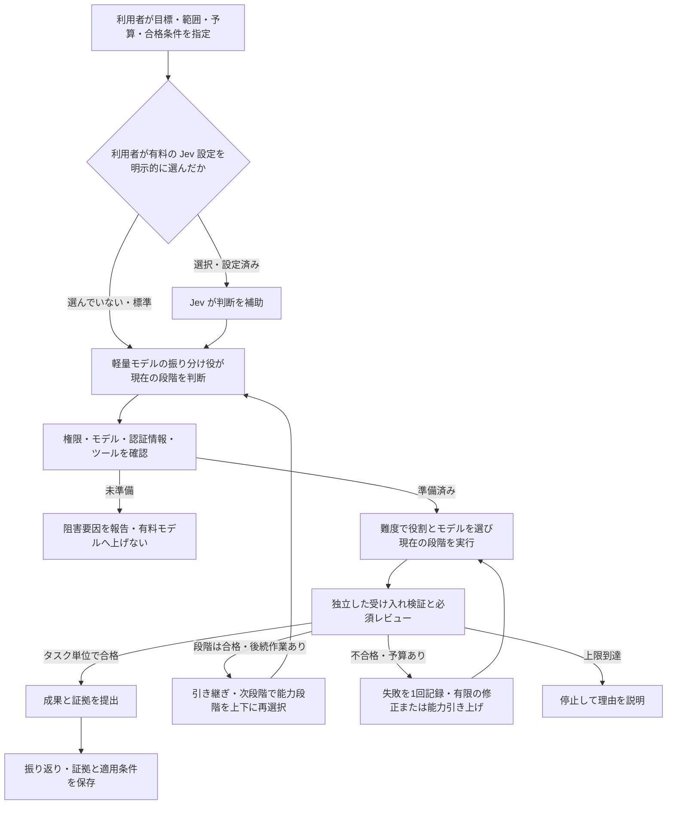
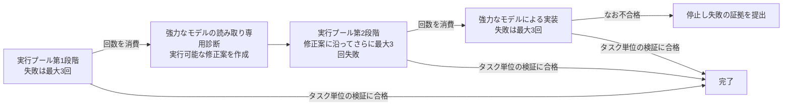

# AI 分業ワークフロー：無料枠を優先し、必要に応じて上位モデルへ切り替え、独立して検証する

**语言 / Language:** [简体中文](../../README.md) | [English](../en/README.md) | **日本語** | [Español](../es/README.md) | [Français](../fr/README.md) | [Português (Brasil)](../pt-BR/README.md)

**現在のタスクに十分な能力のモデルを選び、難しい問題では上位へ切り替えます。解決後は後続作業に適した段階へ戻し、実際の検証結果で成否を判断します。**

初心者と AI Agent 向けのインストール・設定・利用ガイドです。目標、アカウント、許可をあなたが用意し、あなたの Agent が本ガイドに沿って自分の PC を設定します。既存のツールと環境を優先して再利用してください。

> **最初に確認**
> - 🟢 Jev は任意です。標準では軽量モデルが振り分けを判断します。Jev を使いたい場合は明示的に依頼してください。API は有料です。
> - 🟠 無料枠には期間・使用量の制限がある場合があります。有料の代替経路には事前の許可が必要です。
> - 🔴 モデルが「完了」と言っても、受け入れ検証に合格したことにはなりません。
> - このリポジトリはドキュメント集であり、インストーラーではありません。「AI にまとめて依頼」は設定用の指示をコピーすることで、Web ページをクリックすると自動で PC が変更される機能ではありません。

<a id="agent-quick-start"></a>

## 自分の AI にまとめて依頼する

**下のコード枠の右上にあるコピーアイコン（⧉ / Copy）を押し、指示全体を自分の Agent アプリに貼り付けて送信してください。**

先にダウンロードや clone をする必要はありません。2 つのドキュメントの完全な URL が含まれています。Web を読めて、PC の操作を許可された Agent を使ってください。ログイン、確認コード、必要な人による承認は本人が行います。

```text
次の公開リポジトリの2つのドキュメントを読み、現在のアプリと私のPCで、私自身のAI分業ワークフローを設定してください。
リポジトリ：https://github.com/greyano12syp-a11y/ai-workflow-guide
仕様：https://github.com/greyano12syp-a11y/ai-workflow-guide/blob/main/docs/ja/README.md
実行手順：https://github.com/greyano12syp-a11y/ai-workflow-guide/blob/main/docs/ja/AI_SETUP.md
両方を全文読み、README.mdを仕様として、AI_SETUP.mdに従ってローカル環境の確認、必要なインストール、設定、受け入れ検証を行ってください。
私のOS、アプリの能力、既存ツール、アカウント権限に合わせ、私の作業ディレクトリと認証情報を使ってください。作者のパスやアカウントをそのまま使わないでください。
アプリがオンラインで文書を読めない、またはPCを操作できない場合は、制約と私が行うべき手順を説明し、設定済みと主張しないでください。
既存環境を優先し、変更前に設定をバックアップし、このタスクに必要な項目だけ変更してください。
標準では軽量モデルの振り分け役がタスクを判断し、オーケストレーターが作業を割り当てます。Jev分類を自発的に呼び出さないでください。私がJevの設定を明示的に依頼し、費用を許可した場合だけ接続してください。
有料サービスやプラン枠は、私が既に明示的に許可した範囲で使用してください。不明な場合は確認し、未許可の経路を自動フォールバックのプールに入れないでください。
秘密情報は私がPC上で対話的に入力します。チャット、コマンド引数、ログに記載しないでください。ログイン、確認コード、本当の人による承認は私が行います。
モデル名と推論レベルはREADME.mdに照合してください。モデル、認証情報、ツール、権限が不足する場合は阻害要因として報告し、黙って代替しないでください。
文書の手順を実装済みと見なさないでください。既存のオーケストレーターが失敗回数、タイムアウト、権限、候補に結び付いた受け入れ検証を実施できない場合は、不足を説明し、無断で複雑な新システムを開発しないでください。
設定差分、ロールバック方法、実際の受け入れ結果を提出し、設定完了、リクエスト成功、タスク完了を区別してください。
```

Agent はあなたの環境、アカウント権限、許可範囲で設定を進めます。チャット専用アプリは、まず文書を読んで手順を案内できます。実際の完了状況は設定差分と検証結果で判断してください。

## 公式サイト、プロジェクトページ、ローカル API を区別する

| 目的 | 正しい入口 | 利用方法 |
| --- | --- | --- |
| Magpie の製品説明やダウンロードを見る | **[Magpie 公式サイト](https://usemagpie.ai/)** | ブラウザーで開く |
| ソース、リリース、課題を見る | **[Magpie 公式 GitHub](https://github.com/yetone/magpie)** | ブラウザーで開く |
| Codex をローカル Magpie に接続する | `http://127.0.0.1:3425/v1` | **アプリの `base_url` に設定する。Web サイトとして開くものではない** |
| インストール済みの管理画面を使う | Magpie アプリ | アプリ自体から入る |

**`127.0.0.1` はアクセスする人自身の PC を意味します。** 他人がコピーしても作者の PC には接続しません。`/v1` は API のパス接頭辞です。ブラウザーにページが表示されないだけでは、ゲートウェイの故障とは判断できません。

このローカルアドレスは設定値として示しており、公式サイトでも公開共有リンクでもありません。

## 1. 小さなチームの役割を理解する

| 役割 | 担当 |
| --- | --- |
| あなた | 目標、変更可能範囲、費用上限、合格条件 |
| 振り分け役 | 軽量モデルで現在の段階に必要な能力とツールを判断し、オーケストレーターが役割・モデルを割り当てる |
| 計画役 | 複雑なタスクの戦略、大規模な計画、実行配置を設計し、分担を明確にして引き継ぐ |
| 実行役 | 指定範囲で読み取り、整理、変更、検証を行う |
| 検証役 | 事前に決めた検査と必要な独立レビューで成果を確認する |

役割は責任を表し、モデルの段階は現在の作業難度に応じて上下します。複雑な仕事は Astra が戦略と実行計画を立て、その後は軽量の振り分け役と低コストの実行モデルに引き継ぎます。小さな仕事は軽量の流れへ直接進めます。対象ファイルと合格条件が既知なら調査を繰り返しません。ファイルや状態を取り合わず独立に進められる作業だけ並列化します。



Jev の助言は権限を作り出しません。振り分け判断の引き継ぎやモデル変更によって、リスクによる拒否や人の承認を迂回してはいけません。

<a id="jev-option"></a>

## 2. 任意設定：Jev による意思決定支援

**Jev は有料の選択肢です。設定したい場合は Agent に明示的に伝えてください。依頼がなければ、軽量モデルの振り分け役が判断し、Jev 分類を自動で接続・呼び出ししません。**

**できること：** Jev は TypeSafe の意思決定モデルです。選択肢から選ぶ Choice、基準に沿って採点する Score、条件が成立する確率を評価する Noul により、プログラム向けの構造化結果を返します。[公式機能説明](https://docs.typesafe.ai/primitives)を参照してください。

**この流れでの用途：** 許可された短いタスク要約を渡し、主に Choice で必要能力の段階を判断する補助とリスク評価に使います。振り分け役／オーケストレーターが下表に従ってモデルを割り当てます。Jev 自体はコードを書かず、ツールを操作せず、独立検証を代替しません。

設定は [Jev の任意接続](AI_SETUP.md#jev-setup)を参照してください。費用はアカウントの請求条件によって決まり、総費用削減は保証しません。送信するのは許可された短い要約だけで、鍵は安全なローカル設定に保存します。

<a id="tier-assignment"></a>

### タスクの段階と具体的な分担

標準では既存の `group/free-basic` で軽量な分類を行い、オーケストレーターがツール、権限、検証条件を踏まえて、現在の段階に最低限必要な役割・モデルを選びます。**役割は責任、段階は必要能力、タスクの種類は書き込み可否を表します。** 大きな計画は低コストモデルへ引き継いで実行し、難題では既存規則に従って能力を引き上げ、解決後や単純な小タスクでは下げます。同じタスク／集計段階の失敗回数は、能力段階の変更でリセットしません。

| 段階 | 適したタスク・例 | 役割とモデル | 実行方法 |
| --- | --- | --- | --- |
| **L1 · LIGHT** | 既知ファイルの検索、短い要約、手順が完全に明確な機械的変更 | テキストのみは **`group/free-basic`**。ファイル操作は、読み取り専用の **Scout**、許可済み変更の **Operator**。両者は `group/codex-exec-max` / MAX | 軽量判断で選び、オーケストレーターがモデル／プールへ割り当てる。Operator は指定ファイルだけ変更し、本質的な設計問題があれば上位へ進む |
| **L2 · STANDARD** | 範囲が明確な機能実装、通常のバグ修正、資料分析、コードレビュー | 実装は **Coder**：`group/codex-exec-max` / MAX。読み取り専用の分析・通常診断・レビューは **Analyst**：`gpt-6.1-sol` / High | Coder が範囲内で実装し、Analyst は分析・修正案だけを提出してファイルを変更しない。納品後に事前の基準で独立検証 |
| **L3 · DEEP** | 大きな計画、戦略と実行配置、複数モジュールの設計、難しい診断 | **Architect**：`gpt-6-astra` / Xhigh、読み取り専用の計画・診断 | 分割、担当、依存、許可範囲、合格条件を明確にし、軽量振り分けと低コスト実行へ引き継ぐ。Astra は通常の割り当てに継続参加しない。失敗時の昇格条件を満たして初めて許可済み **Astra Executor** が実装 |
| **L4 · HUMAN_GATE** | 不可逆操作、人による判断が必要な権限・リスク | **利用者に確認**。書き込み役を自動で割り当てない | 対象操作を停止し、影響を説明する。許可後に範囲と実行段階を再決定。L4 は人によるゲートであり、高価なモデルではない |

実行プールの優先順は **WorkBuddy DeepSeek → Cloudflare Qwen → 許可済み Luna の代替経路**です。正確な ID は次節に示します。通常の失敗では **Analyst / Sol High** が診断し、**Sol Executor / Sol High** が実装します。難しい仕事では **Architect / Astra Xhigh** と **Astra Executor / Astra Xhigh** を使います。

実装失敗は **実行プール 3 回 → 強力なモデルによる読み取り専用診断 → 実行プールでさらに 3 回 → 強力なモデルによる実装を最大 3 回**で扱います。タスク単位の検証と必須レビューに合格して初めて終了します。計画・診断段階だけの合格は実装完了ではありません。モデル、経路、権限の不足は阻害要因であり、段階を上げても権限や費用許可は生まれません。

## 3. ツールと元のモデル構成

以下は **2026-10-26 時点の参考スナップショット**であり、常に最新版という意味ではありません。別アカウントではモデル権限や無料条件が異なる場合があります。

| ツール | 参考バージョン | 用途 |
| --- | --- | --- |
| [Codex](https://github.com/openai/codex) | `0.163.0` | Agent 実行環境、役割実行、ツール呼び出し |
| [Magpie](https://github.com/yetone/magpie) | `0.1.1453` | モデル経路、グループ、フォールバック |
| [FastCtx](https://github.com/yc-duan/fastctx) | `0.2.5` | ローカル読み取り、検索、コマンド実行 |

Codex のゲートウェイ provider は `magpie`、`wire_api` は `responses`、`base_url` は `http://127.0.0.1:3425/v1` です。実行役のモデルは別に割り当て、利用者の既存セッション設定を保持します。

### 無料優先の実行プール

実行層は**無料優先の実行プール**を使います。グループ名は `codex-exec-max`、呼び出し ID は **`group/codex-exec-max`** です。

**これは独自のルーティンググループ名であり、モデルでも別料金のサービスでもありません。** 実際に作業するのは下表のモデルです。費用は最終的な経路とアカウントで決まります。ルーティングは `order`、親和性は `turn` で、利用可能な経路を順に選んで代替します。リアルタイムの価格比較ではありません。

| 順序 | 正確なメンバー ID | 担当 |
| --- | --- | --- |
| 1 | `workbuddy-ai/deepseek-v4.1-flash:max` | 優先実行 |
| 2 | `cloudflare-ai/@cf/qwen/qwen3.8-27b:xhigh` | 第 2 の実行元 |
| 3 | `codex/gpt-6-luna:max` | 低コストの代替。先に枠・費用の許可を得る |

WorkBuddy は `@magpie-community/opencode-workbuddy-auth@0.1.34` を使い、自分の `workbuddy-ai` アカウントでログインします。Cloudflare は自分のアカウント ID と token を使います。

実行役は MAX 設定ですが、各メンバーは表の推論レベルを使います。Cloudflare は実際には Xhigh です。外側の MAX が全上流で同名パラメーターに対応するとは限りません。

### 基礎的な短いタスク用プール

グループ名は `free-basic`、呼び出し ID は **`group/free-basic`**。同様に `order` と `turn` を使います。

1. `groq/openai/gpt-oss-20b:high`
2. `deepseek-2/deepseek-flash:max`

軽量分類、フィールド抽出、短い要約向けです。Groq は Chat Completions を使います。小さな無料枠は小さなタスクに適します。公称コンテキストが大きくても、長時間の Agent 作業に十分な無料枠があるとは限りません。

### 役割のモデルと権限

| 役割 | モデル／推論レベル | 担当と権限 |
| --- | --- | --- |
| タスク判断 | `group/free-basic` / 各メンバーの設定 | 軽量分類の助言。実際の割り当てはオーケストレーター |
| Scout | 無料優先プール：`group/codex-exec-max` / `max` | 読み取り専用調査 |
| Operator | 無料優先プール：`group/codex-exec-max` / `max` | 許可された明確な操作 |
| Coder | 無料優先プール：`group/codex-exec-max` / `max` | 許可された実装・修正 |
| Analyst | `gpt-6.1-sol` / `high` | 通常問題の読み取り専用診断 |
| Architect | `gpt-6-astra` / `xhigh` | 大きな計画、戦略、実行配置、難題の読み取り専用診断。完了後に引き継ぐ |
| Sol Executor | `gpt-6.1-sol` / `high` | 許可済みの強力なモデルによる実装 |
| Astra Executor | `gpt-6-astra` / `xhigh` | 難しいタスクの昇格後の実装 |

選択、タスク種類、昇格は[タスクの段階と具体的な分担](#tier-assignment)を参照してください。

読み取り専用診断と書き込み実装を分離します。引き継ぐのは目標、必要資料、許可範囲、合格条件だけです。

<details>
<summary>元の最上位スマートグループと Kimi レビュー経路</summary>

元の最上位グループでは、分類器が `group/free-basic`、計画分岐が `codex/gpt-6-astra:xhigh`、実行分岐が `group/codex-exec-max`、レビュー分岐が `group/auto-kimi-k3` です。

Kimi の自動グループは `auto/kimi-k3` と表示される場合もあります。元の構成は `moonshot-cn/kimi-k3`、`opencode-go/kimi-k3`、`moonshot/kimi-k3` を含みますが、実メンバーは自分のアカウントによります。

最上位グループを使う場合はそれが分岐を選びます。役割が既に決まっているタスクは、対応するモデル／プールを直接呼び、再分類しません。自動生成されたグループも実メンバーと費用許可を確認します。グループ内の代替だけで計画・実装・レビューが完了したことにはならず、Kimi の意見も独立検証を代替しません。

</details>

## 4. 費用を制御してから自動フォールバックを有効にする

開始前に、許可する経路・アカウント・枠の上限・枠が尽きた場合の処理を決めます。**未許可の経路を自動呼び出し可能な一覧に残さず、許可後に参考順序で有効化してください。** 制限は設定や呼び出し入口で実施し、プロンプトだけに頼りません。

無料枠は**期間・量・地域・アカウントの制限**があり得て、永続的な無料を保証しません。同じ API でも別アカウントでは有料の場合があります。

枠が尽きたら別の提供元を評価・再設定できます。保守を減らしたいなら、費用を明示的に許可したうえで低コストの有料代替を利用できます。無料枠の消尽は新しい支出許可ではありません。セッション呼び出し、強力なモデル、Luna、一部 Kimi 経路は課金やプラン枠消費の対象となり得ます。

このリポジトリは、個人運営の無料 API 集約サイトの名前・リンク・エンドポイントを紹介せず、推奨もしません。提供元を追加する前に、送信データ範囲、権限、信頼性、費用を再確認してください。

## 5. 失敗の数え方と能力引き上げ

前提条件の不足と経路障害を除外してから能力上の失敗を数えます。

| 状況 | 対応 |
| --- | --- |
| 認証情報・モデル・権限・必須ツールの不足 | 阻害要因を報告して停止。能力失敗に数えず、有料モデルへ自動昇格しない |
| ネットワーク障害、429、枠の消尽 | 別記録し、事前の上限内で処理。無限再試行しない |
| 完全な提出物が独立検証または必須レビューで不合格 | 能力失敗を 1 回計上 |
| 上記の不足・経路障害を除外しても有効な提出物がない、または形式不適合 | 能力失敗を 1 回計上 |
| 同じ提出物のテストとレビューが両方失敗 | それでも 1 回だけ |
| 修正後に再提出 | 新しい実装試行 |
| グループ内の経路変更、自己検査、単一ツール呼び出し | 独立した能力失敗としては数えない |

各集計段階の回数は実行プール全体で共有し、各モデルに 3 回ずつ与えるものではありません。同じ段階の再開やモデル変更でリセットしません。



通常診断は Sol High、難しい診断は Astra Xhigh を使います。強力なモデルによる実装には許可された書き込み役が必要です。実行可能な修正案がない、または次段階の権限・モデル・予算が不足する場合は停止します。どの制限でも途中終了でき、全回数を使い切る必要はありません。

**共通の時間・ステップ基準：**

- 1 つの集計段階で実装試行は最大 3 回。
- 1 回のモデルへの割り当てと付随するツール実行は最大 **600 秒**。
- 1 回の独立した受け入れ検証は別枠で最大 **120 秒**。
- 実装、再試行、診断、レビューを含め、役割への割り当ては最大 **21 回**。単一ツール呼び出しは別ステップに数えない。
- 21 ステップでも 3＋3＋3 の実装回数は増えない。回数・時間・予算のいずれかが先に上限へ達したら停止。

失敗の証拠と既存成果を残し、続きはそこから進めます。回数、タイムアウト、権限、予算は実際の仕組みで制御し、プロンプトの宣言を検証の代わりにしません。

## 6. 何をもって完了とするか

**段階の引き継ぎ合格は次段階へ進む許可にすぎません。利用者の目標に対応する成果物がタスク単位の検証と必須レビューに合格して初めて完了です。** 実装タスクでは診断案の合格だけでは完了しません。

検証とレビューは同じ候補に対応させます。変更後は影響する検査と必要なレビューをやり直し、古くなった合格結果を流用しません。

| 引き継ぎ先 Agent の提出物 | 判断方法 |
| --- | --- |
| 役割設定 | 正確なモデル・レベル・権限・実際の読み込み状態が一致 |
| 呼び出せる振り分け入口 | タスクに応じた役割／モデルグループを呼べる |
| 失敗記録 | タスクと集計段階に結び付き、モデル変更でリセットしない |
| タイムアウト・権限・予算制限 | 実際に有効で、上限時に明示的に停止 |
| 独立検証と必須レビュー結果 | 現在の候補に対応し、呼び出し側が決めた基準を使用 |
| 未準備の報告とロールバック | モデル・認証情報・ツール・許可不足を明示し、設定を復元可能 |

「設定完了」「応答が返った」「タスク検証合格」を別に記録します。HTTP 200、終了コード 0、モデルの完了宣言はタスク検証の代わりになりません。最終モデルを信頼できる形で確認できなければ「未確認」とし、使用量不明をゼロにしません。モデル不足を黙って代替し、完全再現と主張しないでください。

## 7. 初心者は小さなタスクから始める

> 足し算関数を修正し、既存の 4 テストを通す。変更は実装ファイルだけで、テストファイルは変更しない。

まず問題を再現し、実行役に範囲と検証コマンドを明示します。独立した検査プロセスで元のテストと変更禁止ファイルを確認します。合格後は実際の呼び出し、結果、不明な使用量を報告し、不合格なら上記の基準で記録・昇格します。

小さな読み取り専用タスクと変更タスクが動いてから複雑な分業を追加します。GitHub Queue は任意の受付・待ち行列の入口であり、同じ許可・検証経路を通します。Issue 本文自体は書き込み権限や費用許可を付与できません。

## 8. Magpie の機密情報マスキングとアクセス保護

設定、スクリーンショット、ログ、バックアップを公開する前に確認します。

- API key、token、Cookie、OAuth 認証情報、認可ヘッダーをプレースホルダーへ置換。
- アカウント情報、個人メール、非公開リポジトリ URL、私有パス、URL 内のアカウント識別子を除去。
- 全チャット、生のリクエスト／応答ログ、認証キャッシュ、未レビューの設定出力やバックアップは公開しない。
- Magpie のマスキング機能を使う場合、インストール版の公式説明で設定を確認し、合成サンプルで検証する。機能名だけで全機密情報が保護されると判断しない。

**ゲートウェイが実際に `127.0.0.1` などのローカルアドレスだけで待ち受けているか確認してください。クライアントの localhost 設定だけではサーバーの外部公開を否定できません。** 標準でインターネット／LAN 共有、ポート転送、認証なしプロキシを有効にしません。遠隔利用が必要なら、認証、暗号化接続、アクセス制限を別途設定します。

信頼できるツールとプラグインを使い、認証ファイルの読み取り権限を制限し、公開リポジトリや管理されない共有場所へ入れないでください。

**マスキングは漏えいリスクを下げますが、不正侵入防止を保証しません。** 漏れた認証情報は失効・更新し、アクセス記録を確認します。公開文面を削除するだけでは解決しません。

## 9. 証拠と振り返りの範囲

2026-10-26 までの元プロジェクトの記録には、Windows 上の実 CLI ツール呼び出し、無料プールでの小さなコード修正、基礎分類・抽出・要約、隔離された読み取り専用キューの検証があります。別のアカウントや環境での成功を保証するものではありません。

一定の効果を約束できる完全な請求書や厳密な費用比較はありません。永続的無料、固定の節約率、全タスクの高速化を約束しません。本ガイドで補足した実行基準は、接続先環境で個別に検証してください。

終了後は手法、証拠、適用条件、失敗例を記録します。経験は候補として扱い、グローバル規則を自動変更しません。旧タスクの PASS は新タスクの合格を証明しません。

---

**AI 向けの実行順序と完了条件：** [AI_SETUP.md](AI_SETUP.md)

本ページは GitHub 対応の Mermaid 図と Markdown 表を使用し、独自 Web サービスに依存しません。[GitHub 公式の図表説明](https://docs.github.com/en/get-started/writing-on-github/working-with-advanced-formatting/creating-diagrams)を参照してください。

---

<a id="support"></a>

## 任意の応援

この AI 分業ワークフローの開発・テスト・文書整理には約 2 か月と相応の実費を費やしました。役立った場合は、今後のテスト、文書作成、保守への任意の応援を歓迎します。

**応援は完全に任意で、金額も自由です。応援の有無にかかわらず、本リポジトリの公開内容は無料で取得・利用できます。**

WeChat Pay、Alipay、Payoneer の受取コードです。画像をクリックすると原寸を確認できます。応援ありがとうございます。

<p align="center">
  <a href="../../assets/support/wechat-pay.png"></a>
  <a href="../../assets/support/alipay.jpg"></a>
  <a href="../../assets/support/payoneer.png"></a>
</p>
