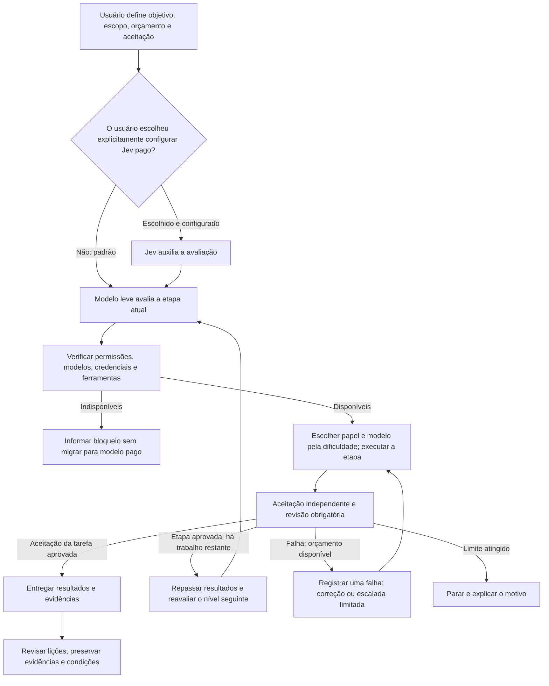
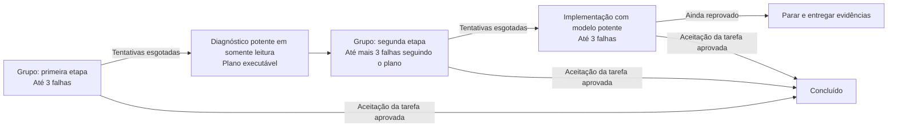

# Fluxo de trabalho com IA: priorizar o gratuito, subir de nível quando necessário e verificar de forma independente

**语言 / Language:** [简体中文](../../README.md) | [English](../en/README.md) | [日本語](../ja/README.md) | [Español](../es/README.md) | [Français](../fr/README.md) | **Português (Brasil)**

**Escolha um modelo com capacidade suficiente para a tarefa atual. Use um modelo mais capaz nos problemas difíceis, volte ao nível adequado depois de resolvê-los e avalie o resultado com verificações reais.**

Guia de instalação, configuração e uso para iniciantes e agentes de IA. Você fornece o objetivo, as contas e a autorização; seu agente configura seu computador seguindo este guia. Reutilize primeiro as ferramentas e o ambiente existentes.

> **Leia primeiro**
> - 🟢 Jev é opcional. Por padrão, um modelo leve avalia a distribuição das tarefas. Peça Jev explicitamente se quiser usá-lo: sua API é paga.
> - 🟠 Cotas gratuitas podem ter limites de tempo e uso. Uma alternativa paga exige autorização prévia.
> - 🔴 O modelo dizer «concluído» não significa aprovação na validação de aceitação.
> - Este repositório contém documentação, não um instalador. «Entregar à sua IA» significa copiar uma tarefa de configuração, não alterar automaticamente o computador ao clicar em uma página.

<a id="agent-quick-start"></a>

## Entregue a configuração à sua própria IA

**Clique no ícone de copiar (⧉ / Copy) no canto superior direito do bloco e envie a instrução completa no seu aplicativo de agentes.**

Não é preciso baixar ou clonar o repositório antes: as URLs completas dos dois documentos estão incluídas. Use um agente capaz de ler páginas e autorizado a operar seu computador. Você mesmo deve realizar login, códigos de verificação e aprovações humanas necessárias.

```text
Leia os dois documentos deste repositório público e configure meu próprio fluxo de trabalho com IA no aplicativo atual e no meu computador.
Repositório: https://github.com/greyano12syp-a11y/ai-workflow-guide
Especificação: https://github.com/greyano12syp-a11y/ai-workflow-guide/blob/main/docs/pt-BR/README.md
Etapas de execução: https://github.com/greyano12syp-a11y/ai-workflow-guide/blob/main/docs/pt-BR/AI_SETUP.md
Leia ambos integralmente. Use README.md como especificação e siga AI_SETUP.md para inspeção local, instalação necessária, configuração e validação de aceitação.
Adapte a configuração ao meu sistema operacional, aplicativo, ferramentas e permissões. Use meu diretório e minhas credenciais, não os caminhos ou contas do autor.
Se o aplicativo não puder ler os documentos online ou operar meu computador, explique as limitações e o que eu preciso fazer. Não afirme que a configuração foi concluída.
Reutilize o ambiente, faça backup antes de alterar configurações e modifique somente o necessário para esta tarefa.
Por padrão, um modelo leve no papel de distribuição avalia as tarefas e o orquestrador atribui o trabalho. Não chame Jev para classificação por iniciativa própria. Integre-o apenas se eu pedir explicitamente e autorizar o custo.
Use serviços pagos ou cotas de planos apenas dentro da minha autorização explícita existente. Pergunte se houver dúvida. Canais não autorizados não podem entrar nas alternativas automáticas.
Eu inserirei os segredos de forma interativa no meu computador. Não os escreva no chat, em argumentos de comandos ou logs. Eu farei login, códigos e aprovações humanas reais.
Confira nomes dos modelos e níveis de raciocínio com README.md. Informe modelos, credenciais, ferramentas ou permissões ausentes; não os substitua silenciosamente.
Não trate o fluxo documentado como já implementado. Se o orquestrador não aplicar contagem de falhas, tempos limite, permissões ou validação vinculada ao candidato, explique a lacuna sem desenvolver um sistema complexo novo sem autorização.
Entregue as alterações, a forma de revertê-las e os resultados reais de aceitação. Diferencie configuração concluída, solicitação bem-sucedida e tarefa concluída.
```

O agente atua conforme seu ambiente, permissões e autorização. Um aplicativo apenas de chat pode ler os documentos e orientar os passos. A conclusão real depende das diferenças de configuração e dos resultados de aceitação.

## Diferencie site oficial, projeto e API local

| Objetivo | Entrada correta | Como usar |
| --- | --- | --- |
| Conhecer Magpie e encontrar informações e downloads | **[Site do Magpie](https://usemagpie.ai/)** | Abrir no navegador |
| Consultar código, versões e problemas | **[Projeto oficial do Magpie](https://github.com/yetone/magpie)** | Abrir no navegador |
| Conectar Codex ao Magpie local | `http://127.0.0.1:3425/v1` | **Preencher o `base_url`; é uma API, não uma página** |
| Usar a interface local instalada | Aplicativo Magpie | Abrir o próprio aplicativo |

**`127.0.0.1` representa o computador de quem acessa.** Copiar o endereço não conecta outra pessoa ao computador do autor. `/v1` é um prefixo de API; não aparecer uma página no navegador não comprova defeito no gateway.

O endereço local é apenas um valor de configuração, não o site oficial nem um link público.

## 1. Entenda a pequena equipe

| Papel | Responsabilidade |
| --- | --- |
| Você | Objetivo, alterações permitidas, teto de custo e critérios de aceitação |
| Distribuidor | Avaliar capacidade e ferramentas da etapa com modelo leve; o orquestrador atribui papéis e modelos |
| Planejador | Definir estratégia, planejamento amplo e organização da execução de tarefas complexas, depois repassar o trabalho |
| Executor | Ler, organizar, alterar ou verificar dentro de um escopo claro |
| Verificador | Conferir resultados com verificações previstas e revisão independente obrigatória |

Papéis indicam responsabilidades; os modelos sobem ou descem de nível conforme a dificuldade da etapa. Astra planeja a estratégia e a execução complexa, depois repassa à distribuição leve e a modelos econômicos. Tarefas pequenas entram diretamente no fluxo leve. Não repita a exploração se arquivos e critérios já forem conhecidos. Paralelize somente atividades independentes que não disputem arquivos ou estado.



Uma recomendação de Jev não concede permissões. Assumir a decisão de distribuição ou mudar de nível não contorna rejeições de risco nem aprovação humana.

<a id="jev-option"></a>

## 2. Opção: apoio à decisão com Jev

**Jev é pago. Peça explicitamente ao agente para configurá-lo. Sem esse pedido, um modelo leve avalia as tarefas; a classificação Jev não é integrada nem chamada automaticamente.**

**O que faz:** Jev é o modelo de decisão da TypeSafe. Seleciona opções (Choice), pontua segundo critérios (Score) ou estima a probabilidade de uma condição (Noul), retornando dados estruturados. Veja a [documentação oficial](https://docs.typesafe.ai/primitives).

**Uso neste fluxo:** enviar um resumo curto autorizado, principalmente usando Choice para auxiliar na seleção de capacidade e identificação de riscos. O distribuidor/orquestrador atribui os modelos conforme a tabela. Jev não escreve código, opera ferramentas nem substitui a aceitação independente.

Veja a [integração opcional de Jev](AI_SETUP.md#jev-setup). A cobrança depende da conta; não há garantia de economia total. Envie apenas resumos curtos autorizados e mantenha as chaves em configuração local segura.

<a id="tier-assignment"></a>

### Níveis e atribuições

Por padrão, `group/free-basic` fornece classificação leve. O orquestrador escolhe o papel e o modelo de menor capacidade suficiente para a etapa, considerando ferramentas, permissões e aceitação. **O papel define responsabilidade; o nível, capacidade; o tipo de tarefa, permissão de escrita.** Entregue grandes planos a modelos econômicos para executar. Suba de nível diante de dificuldades e reduza após resolvê-las ou entrar em subtarefas simples. A contagem da mesma tarefa/etapa não é reiniciada ao mudar de nível.

| Nível | Tarefas e exemplos | Papel e modelo | Organização |
| --- | --- | --- | --- |
| **L1 · LIGHT** | Busca de arquivos conhecidos, resumos curtos, mudanças mecânicas totalmente definidas | Texto: **`group/free-basic`**. Arquivos: **Scout** em somente leitura e **Operator** para mudanças autorizadas; ambos `group/codex-exec-max` / MAX | Avaliação leve e distribuição pelo orquestrador. Operator altera somente arquivos indicados; decisões reais de projeto exigem escalada |
| **L2 · STANDARD** | Implementação delimitada, bugs comuns, análise ou revisão de código | **Coder**: `group/codex-exec-max` / MAX. Análise, diagnóstico comum ou revisão em somente leitura: **Analyst**, `gpt-6.1-sol` / High | Coder implementa no escopo; Analyst analisa ou propõe correções sem editar arquivos. Aceitação independente pelos critérios prévios |
| **L3 · DEEP** | Planejamento amplo, estratégia e execução, arquitetura entre módulos, diagnóstico difícil | **Architect**: `gpt-6-astra` / Xhigh; planejamento e diagnóstico em somente leitura | Definir divisão, papéis, dependências, escopo e aceitação; repassar à distribuição leve e execução econômica. Astra não permanece na coordenação rotineira. **Astra Executor** autorizado implementa após os critérios de escalada |
| **L4 · HUMAN_GATE** | Ações irreversíveis ou decisões humanas sobre permissões/riscos | **Consultar o usuário**, sem atribuir escrita automaticamente | Pausar a ação e explicar impactos; após autorização, redefinir escopo e nível executável. L4 é um controle humano, não um modelo mais caro |

Prioridade: **WorkBuddy DeepSeek → Cloudflare Qwen → Luna de reserva autorizado**. IDs exatos na próxima seção. Casos comuns: diagnóstico com **Analyst / Sol High**, implementação com **Sol Executor / Sol High**. Casos difíceis: **Architect / Astra Xhigh** e **Astra Executor / Astra Xhigh**.

Falhas de implementação seguem **3 tentativas do grupo → diagnóstico potente em somente leitura → mais 3 tentativas do grupo → até 3 implementações com modelo potente**. Termine apenas com aceitação da tarefa e revisão obrigatória aprovadas. Aprovar planejamento ou diagnóstico não conclui implementação. Modelos, canais ou permissões indisponíveis são bloqueios; subir de nível não cria permissão nem autorização de gasto.

## 3. Ferramentas e modelos da configuração original

Esta é uma **referência de 2026-10-26**, não uma declaração de que essas versões serão sempre atuais. Acesso a modelos e condições gratuitas variam por conta.

| Ferramenta | Versão de referência | Uso |
| --- | --- | --- |
| [Codex](https://github.com/openai/codex) | `0.163.0` | Ambiente de agentes, papéis e ferramentas |
| [Magpie](https://github.com/yetone/magpie) | `0.1.1453` | Canais, grupos e alternativas |
| [FastCtx](https://github.com/yc-duan/fastctx) | `0.2.5` | Leitura, busca e comandos locais |

O provider de gateway do Codex é `magpie`, `wire_api` é `responses` e `base_url` é `http://127.0.0.1:3425/v1`. Vincule modelos aos papéis separadamente e preserve as configurações de sessão do usuário.

### Grupo de execução com prioridade ao gratuito

Nome: `codex-exec-max`; ID de chamada: **`group/codex-exec-max`**.

**Esse ID é um grupo personalizado de roteamento, não um modelo nem um serviço cobrado separadamente.** Os modelos abaixo executam; o custo depende do canal efetivo e da conta. Roteamento `order`, afinidade `turn`: selecionar fontes disponíveis em ordem e recorrer às seguintes. Isso não compara preços em tempo real.

| Ordem | ID exato | Função |
| --- | --- | --- |
| 1 | `workbuddy-ai/deepseek-v4.1-flash:max` | Execução prioritária |
| 2 | `cloudflare-ai/@cf/qwen/qwen3.8-27b:xhigh` | Segunda fonte |
| 3 | `codex/gpt-6-luna:max` | Alternativa econômica, com autorização prévia de cota ou custo |

WorkBuddy usa `@magpie-community/opencode-workbuddy-auth@0.1.34` e sua conta `workbuddy-ai`. Cloudflare usa seu próprio ID de conta e token.

Os papéis de execução usam MAX, mas cada membro usa o nível da tabela. Cloudflare usa Xhigh; o MAX externo não significa que todos os provedores aceitem um parâmetro de mesmo nome.

### Grupo básico de tarefas curtas

Nome: `free-basic`; ID: **`group/free-basic`**. Também usa `order` e `turn`:

1. `groq/openai/gpt-oss-20b:high`
2. `deepseek-2/deepseek-flash:max`

Para classificação leve, extração de campos e resumos curtos. Groq usa Chat Completions. Pequenas cotas gratuitas servem para pequenas tarefas; uma janela de contexto anunciada grande não garante cota para longas execuções de agentes.

### Modelos e permissões dos papéis

| Papel | Modelo / raciocínio | Responsabilidade e permissões |
| --- | --- | --- |
| Avaliação | `group/free-basic` / configurações dos membros | Sugestão de classificação; o orquestrador distribui |
| Scout | Grupo gratuito prioritário: `group/codex-exec-max` / `max` | Exploração em somente leitura |
| Operator | Grupo gratuito prioritário: `group/codex-exec-max` / `max` | Operações explícitas autorizadas |
| Coder | Grupo gratuito prioritário: `group/codex-exec-max` / `max` | Código e correções autorizados |
| Analyst | `gpt-6.1-sol` / `high` | Diagnóstico comum em somente leitura |
| Architect | `gpt-6-astra` / `xhigh` | Planejamento amplo, estratégia, organização da execução ou diagnóstico difícil em somente leitura; depois repassa |
| Sol Executor | `gpt-6.1-sol` / `high` | Implementação potente autorizada |
| Astra Executor | `gpt-6-astra` / `xhigh` | Implementação após escalada de tarefa difícil |

Veja [níveis e atribuições](#tier-assignment). Separe diagnóstico em somente leitura e implementação com escrita. O repasse inclui apenas objetivo, material necessário, escopo permitido e critérios de aceitação.

<details>
<summary>Grupo inteligente superior original e canais de revisão Kimi</summary>

O classificador superior é `group/free-basic`; planejamento: `codex/gpt-6-astra:xhigh`; execução: `group/codex-exec-max`; revisão: `group/auto-kimi-k3`.

O grupo automático Kimi também pode aparecer como `auto/kimi-k3`. A configuração original envolvia `moonshot-cn/kimi-k3`, `opencode-go/kimi-k3` e `moonshot/kimi-k3`; os membros reais dependem da conta.

Ao usar o grupo superior, ele escolhe o ramo. Tarefas com papel já atribuído chamam diretamente o modelo/grupo vinculado, sem reclassificar. Confira membros reais e custos autorizados de grupos gerados automaticamente. Alternar fontes não equivale a concluir planejamento, implementação e revisão; a opinião de Kimi não substitui a aceitação independente.

</details>

## 4. Controle o custo antes de habilitar alternativas automáticas

Defina canais, contas, cotas máximas e a ação ao esgotá-las. **Canais não autorizados não devem permanecer em listas invocáveis automaticamente; habilite-os na ordem de referência somente após autorização.** Aplique limites na configuração ou na entrada de chamada, não só em prompts.

Cotas gratuitas podem ter **limites de tempo, volume, região ou conta** e não são garantidas para sempre. A mesma API pode ser paga em outra conta.

Ao esgotar a cota, avalie e configure outra fonte, ou autorize explicitamente uma alternativa paga econômica se preferir menos manutenção. O esgotamento não concede autorização de gasto. Chamadas de sessão, modelos potentes, Luna e alguns canais Kimi podem cobrar ou consumir cotas do plano.

Este repositório não fornece nomes, links ou interfaces de sites pessoais agregadores de API gratuitas, nem os endossa. Reavalie escopo dos dados enviados, permissões, confiabilidade e custos antes de adicionar fontes.

## 5. Como contar falhas e escalar

Primeiro separe bloqueios de pré-requisitos e falhas de canal das falhas de capacidade.

| Situação | Tratamento |
| --- | --- |
| Faltam credenciais, modelos, permissões ou ferramentas necessárias | Informar e parar; não consumir tentativas de capacidade nem migrar automaticamente para pago |
| Erro de rede, 429, cota esgotada | Registrar separadamente e respeitar limites; sem repetição infinita |
| Entrega completa reprovada na aceitação independente ou revisão obrigatória | Uma falha de capacidade |
| Sem entrega válida ou formato incorreto após excluir os bloqueios/falhas de canal anteriores | Uma falha de capacidade |
| Testes e revisão reprovam a mesma entrega | Continua sendo uma falha |
| Nova entrega após correção | Nova tentativa de implementação |
| Troca interna de canal, autoverificação ou chamada de ferramenta | Não conta como falha de capacidade separada |

O grupo inteiro compartilha a contagem de cada etapa; não são três tentativas por modelo. Retomar a mesma etapa ou trocar de modelo não reinicia o contador.



Use Sol High para diagnóstico comum e Astra Xhigh para o difícil. Implementação potente exige papel de escrita autorizado. Pare se não houver plano executável ou faltarem permissões, modelos ou orçamento na próxima etapa. Qualquer limite pode encerrar antes; não é necessário gastar todas as tentativas.

**Limites comuns de tempo e etapas:**

- Até três tentativas de implementação por etapa de contagem.
- Cada atribuição a modelo e suas ferramentas: até **600 segundos**.
- Cada aceitação independente tem limite separado de **120 segundos**.
- Até **21 atribuições de papéis**, incluindo implementação, novas tentativas, diagnóstico e revisão. Chamadas individuais de ferramentas não são etapas extras.
- As 21 etapas não aumentam as 3+3+3 tentativas. Pare ao atingir primeiro qualquer limite de tentativas, tempo ou orçamento.

Preserve evidências de falhas e resultados existentes para continuar deles. Contadores, tempos, permissões e orçamento precisam de mecanismos reais; declarar em um prompt não substitui verificar.

## 6. O que significa concluir

**Aprovar o repasse de uma etapa apenas permite avançar. A conclusão exige que o entregável do objetivo do usuário passe na aceitação da tarefa e na revisão obrigatória.** Um diagnóstico aprovado não conclui uma implementação.

Aceitação e revisão devem corresponder ao mesmo candidato. Após alterações, repita verificações afetadas e revisões necessárias, sem reaproveitar aprovações obsoletas.

| Entrega do agente que recebe o trabalho | Critério |
| --- | --- |
| Configuração dos papéis | Modelos exatos, níveis, permissões e carregamento real correspondem |
| Entrada de distribuição invocável | Chama o papel/grupo apropriado para a tarefa |
| Registros de falhas | Vinculados à tarefa/etapa, sem reiniciar ao mudar modelo |
| Tempos limite e permissões/orçamento | Aplicação real e parada explícita no limite |
| Aceitação independente e revisão obrigatória | Candidato atual e critérios definidos por quem solicita |
| Bloqueios e reversão | Carências explícitas e configuração restaurável |

Registre separadamente «configuração concluída», «solicitação respondida» e «tarefa aceita». HTTP 200, código de saída 0 e declaração do modelo não substituem a aceitação. Sem identificação confiável do modelo final, marque «não verificado». Uso desconhecido não é zero. Não substitua modelos silenciosamente e afirme reprodução exata.

## 7. Comece com uma tarefa pequena

> Corrigir uma função de soma para passar nos quatro testes existentes. Alterar apenas a implementação, nunca os testes.

Reproduza o problema, forneça escopo e comando de aceitação, e use um processo independente para verificar testes originais e arquivos protegidos. Informe chamadas reais, resultados e consumo desconhecido; se falhar, registre e escale pelas regras anteriores.

Faça pequenas tarefas de leitura e edição antes de ampliar a divisão de trabalho. GitHub Queue é uma entrada opcional de recebimento e fila, sujeita à mesma cadeia de autorização e aceitação. O texto de uma Issue não concede permissão de escrita nem de gasto.

## 8. Mascaramento e proteção de acesso no Magpie

Antes de publicar configuração, capturas, logs ou backups:

- Substitua API keys, tokens, Cookies, credenciais OAuth e cabeçalhos de autorização por marcadores.
- Remova contas, e-mails pessoais, repositórios privados, caminhos privados e identificadores de conta em URLs.
- Não publique conversas completas, registros brutos de solicitações/respostas, caches de autenticação ou exportações/backups não revisados.
- Se usar o mascaramento do Magpie, confira a configuração pela documentação oficial da versão instalada e teste com amostras sintéticas. O nome da função não prova proteção de todos os dados.

**Confira se o gateway realmente escuta apenas em endereço local, como `127.0.0.1`. Usar localhost no cliente não prova que o servidor não está exposto.** Não habilite por padrão acesso público/LAN, encaminhamento de portas ou proxy sem autenticação. Para acesso remoto, configure autenticação, conexão criptografada e restrições separadamente.

Use ferramentas e plugins confiáveis. Restrinja leitura das credenciais e mantenha-as fora de repositórios públicos e pastas compartilhadas sem controle.

**Mascarar reduz o risco de vazamento, mas não garante prevenção de invasões.** Revogue ou rotacione credenciais expostas e confira os registros de acesso. Apagar o texto público não resolve sozinho um vazamento.

## 9. Limites das evidências e lições

Até 2026-10-26, os registros do projeto original abrangem chamadas CLI reais no Windows, pequenas correções pelo grupo gratuito, classificação/extração/resumos básicos e filas isoladas de somente leitura. Não garantem sucesso em outras contas ou ambientes.

Não existe fatura completa ou comparação rigorosa de custos que sustente promessa de ganho fixo. O guia não promete gratuidade permanente, porcentagem fixa de economia nem rapidez superior em todas as tarefas. Verifique cada regra adicional de execução no seu ambiente.

Registre métodos, evidências, condições de aplicação e falhas. As lições são candidatas, sem alteração automática de regras globais. O PASS de uma tarefa anterior não comprova aprovação da próxima.

---

**Ordem de execução e condições de conclusão para IA:** [AI_SETUP.md](AI_SETUP.md)

Esta página usa diagramas Mermaid e tabelas Markdown compatíveis com GitHub, sem serviço web próprio. Veja a [documentação oficial de diagramas](https://docs.github.com/en/get-started/writing-on-github/working-with-advanced-formatting/creating-diagrams).

---

<a id="support"></a>

## Apoio voluntário

O desenvolvimento, os testes e a documentação deste fluxo levaram cerca de dois meses e envolveram gastos consideráveis. Se o guia ajudar, seu apoio voluntário a novos testes, documentação e manutenção será bem-vindo.

**O apoio é totalmente opcional, e o valor é livre. Todo o conteúdo público continua gratuito para acessar e usar, com ou sem contribuição.**

Códigos de WeChat Pay, Alipay e Payoneer abaixo. Clique na imagem para ver o original. Obrigado pelo apoio!

<p align="center">
  <a href="../../assets/support/wechat-pay.png"></a>
  <a href="../../assets/support/alipay.jpg"></a>
  <a href="../../assets/support/payoneer.png"></a>
</p>
